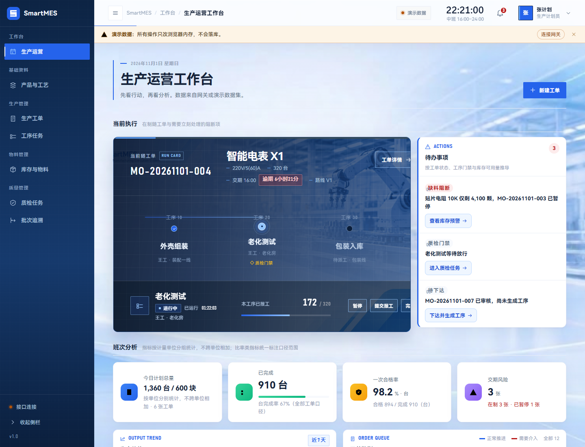
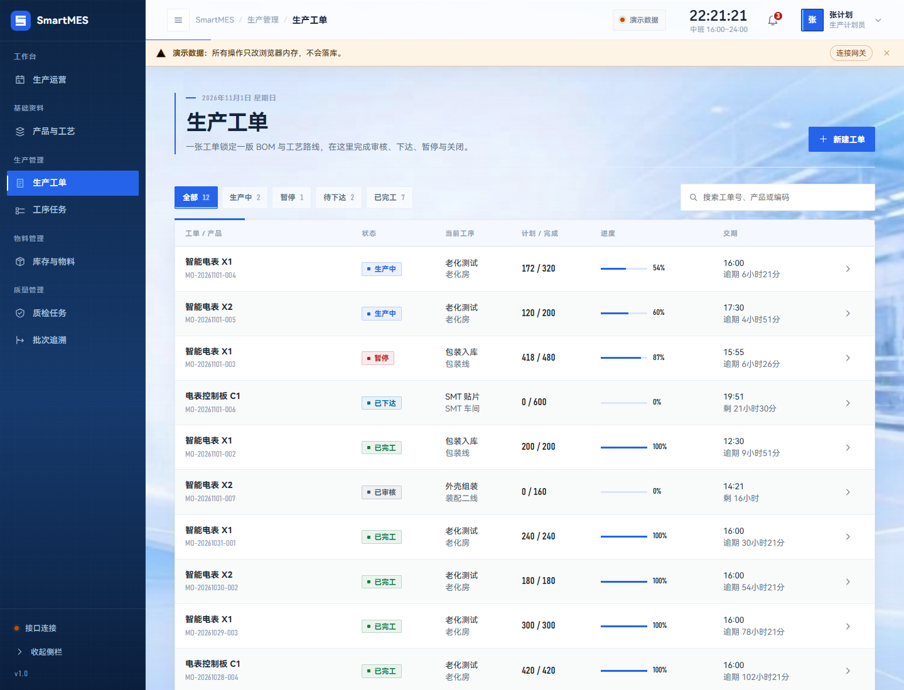
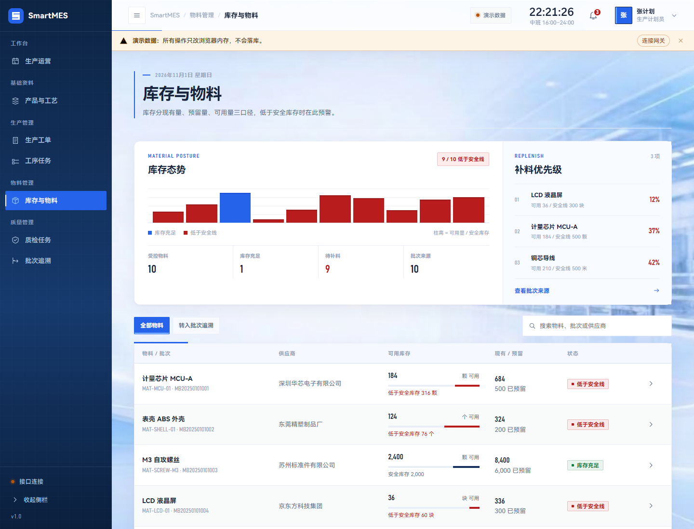
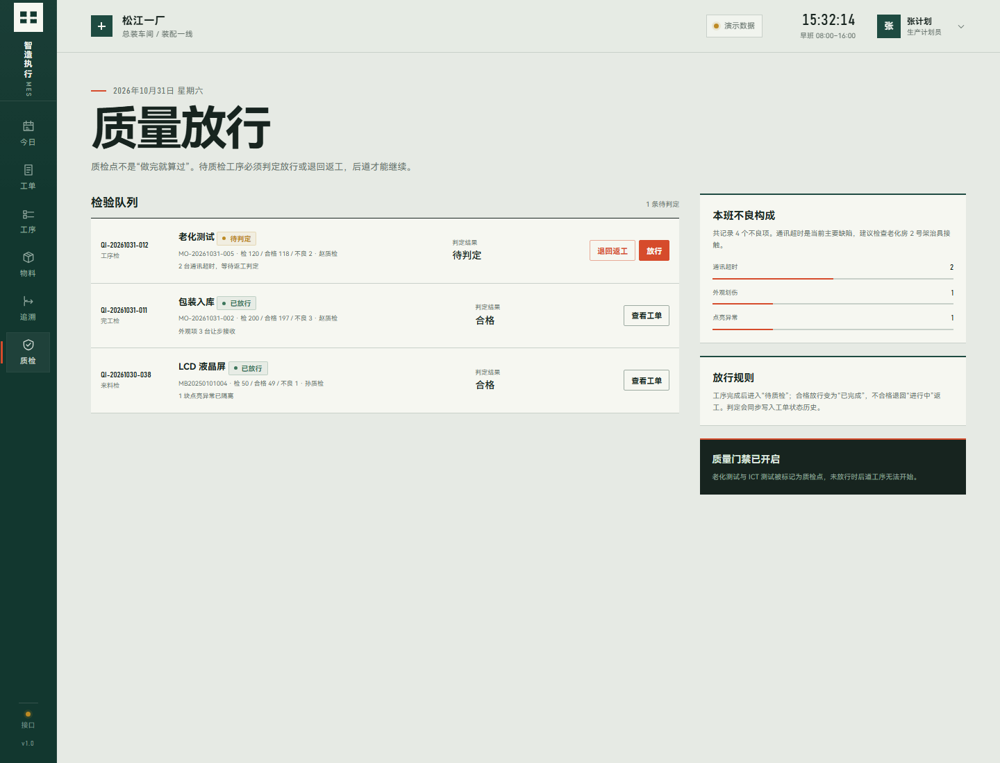
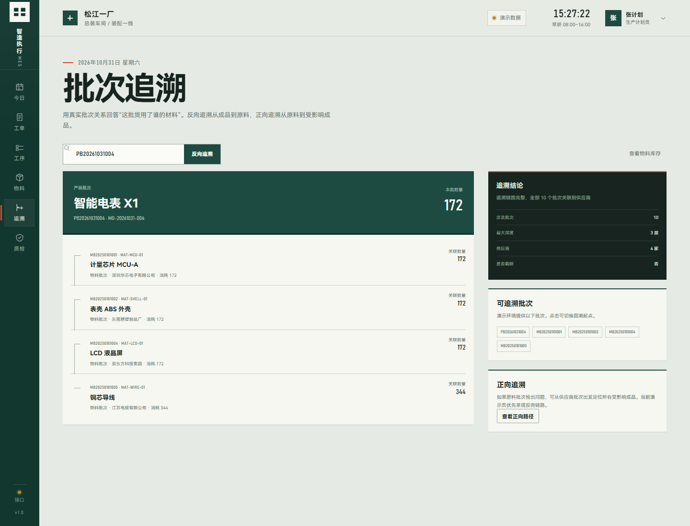
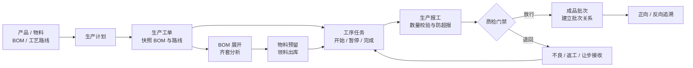
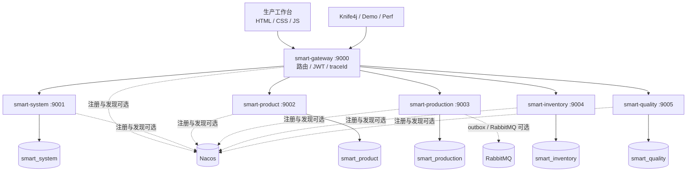

# 智造执行 MES · Smart-Manufacturing

> 面向离散制造业的轻量级 MES。把「计划 → 工单 → 物料预留 → 领料 → 工序报工 → 质检 → 批次追溯」串成一条可运行、可验证的生产闭环，并用一套现场感明确的数字随工单工作台呈现车间状态。

[]()
[]()
[]()
[]()
[]()
[]()

[快速开始](#快速开始) · [系统架构](#系统架构) · [关键设计](#关键设计) · [验证结果](#验证结果) · [文档索引](#文档索引)



---

## 项目是什么

这是一个面向**离散制造**场景的轻量级 MES（Manufacturing Execution System，制造执行系统）。它不是要替代 ERP，而是补齐 ERP 计划层与车间执行层之间的断层：计划部门排了什么、仓库有没有料、工人做到哪道工序、质检有没有放行、出了问题能不能追到物料批次。

项目围绕一个具体的演示产品展开：智能电表 X1。它有一份 7 行明细的 BOM、一条 3 道工序的工艺路线、若干原材料批次和一组不同角色的演示账号。打开工作台，看到的不是抽象的后台表格，而是一张跟着产品穿过工序的**数字随工单**。

### 目标用户

| 角色 | 进入系统后最关心的问题 | 对应页面 |
|---|---|---|
| 生产计划员 / 车间主管 | 今天做到哪了？哪张工单会拖交期？ | 今日生产、工单队列、决策栏 |
| 班组长 / 操作工 | 当前工序要做什么？怎么开始、暂停、报工？ | 工序任务、工单详情 |
| 仓库协同人员 | 物料齐不齐？现有量、预留量、可用量各是多少？ | 物料齐套 |
| 质检员 | 哪道工序卡在质检？这批能不能放行？ | 质量放行 |
| 质量 / 售后人员 | 出问题的成品用了哪些原料？某批原料流向了哪些成品？ | 批次追溯 |

### 四个现场问题

MES 的价值不在于“多一个后台”，而在于及时回答四个问题：

| 问题 | 系统回答方式 | 主要模块 |
|---|---|---|
| **做什么** | 生产计划转生产工单，确认、审核、下达 | production-service |
| **用什么做** | BOM 展开物料需求、齐套分析、预留、领料 | product-service + inventory-service |
| **怎么做、做到哪了** | 工艺路线生成工序任务，开始/暂停/完工，生产报工 | production-service |
| **做得怎么样** | 质检单、不良记录、质量门禁、正反向批次追溯 | quality-service |

### 能力边界

把边界写清楚，比假装什么都能做更重要：

| 维度 | 本项目覆盖 | 本项目不覆盖 |
|---|---|---|
| 制造类型 | 离散制造（电子、机械等组装类） | 流程制造（配方、罐批、连续生产） |
| 生产模式 | MTO 按订单生产 + 简单 MTS | ATO / ETO、复杂混流生产 |
| 排程 | 人工指定计划日期 | APS 自动排程、产能仿真 |
| BOM / MRP | 多层 BOM 树展示，单层物料需求计算 | 递归 MRP、提前期、批量规则 |
| 组织规模 | 单工厂、单车间、多工作中心 | 多工厂、多组织、集团级部署 |
| 设备 | 不接设备 | SCADA、OPC-UA、OEE 实时采集 |
| 成本 | 不核算成本 | 标准成本、实际成本、差异分析 |
| 定位 | 可演示、可验证的工程作品 | 未经改造直接上生产的商业 MES |

---

## 生产工作台

工作台入口：**http://localhost:9000/**。它由网关直接托管，使用原生 HTML / CSS / JavaScript，没有额外的 Node 构建步骤，也不改变现有 REST 路由。

### 设计概念：数字随工单

制造业里的纸质随工单会跟着一批产品穿过各道工序，记录数量、责任人、质检结果。工作台把这个现场物件转成数字界面：

- 首屏不是“大数字 + 渐变卡片”，而是一张正在流动的随工单。
- 工艺路线使用真实工序号 **10 / 20 / 30** 连接，质检点用菱形门禁标记。
- 当前工位是一个信号灯节点，路线只填充到当前工序；完成、进行中、待开始拥有不同结构状态。
- 「待办事项」与随工单并排放在首屏，只列会阻断后道的异常（缺料、质检门禁、待下达），每条带跳转按钮。
- 页面信息顺序遵循现场决策顺序：**先看当前执行 → 再看班次分析 → 必要时追溯**。

### 设计语言

浅色数据面板 + 标准蓝：页面浅底、白色圆角卡片、柔和投影，颜色承载状态而不是装饰。

| Token | 色值 | 页面含义 |
|---|---|---|
| `--board` | `#f5f7fb` | 页面底色 |
| `--paper` | `#ffffff` | 卡片与数据面 |
| `--ink` | `#16233a` | 正文 |
| `--accent` | `#2563eb` | 品牌蓝：主操作、折线、激活态 |
| `--forest` | `#16325f` | 左侧导航深蓝底 |
| `--signal` | `#d92d20` | 风险、暂停、缺口 |
| `--caution` | `#dc6803` | 质检门禁与提醒 |

字体分工对应内容：中文正文使用 `HarmonyOS Sans SC / Microsoft YaHei`；工单号、批次号、数量和进度使用 `Bahnschrift SemiCondensed` 并启用等宽数字，方便在队列中纵向比较；顶部班次时钟单独换用人文无衬线（`Segoe UI Variable / SF Pro Display / PingFang SC`），避免窄体机械字带来的仪表读数感。

整页背景使用车间实景图（`static/assets/app-bg.png`），叠一层很轻的浅色薄纱压对比度，`background-attachment: fixed` 让滚动时背景不动；移动端（≤820px）改回 `scroll` 避免卡顿。

版式按**三个分区**组织，每区一个轻量标题，避免一长串同权重卡片：

| 分区 | 内容 |
|---|---|
| **当前执行** | 随工单（2fr）+ 待办事项（1fr）并排，计划员一进来先看到异常 |
| **班次分析** | 4 张 KPI 卡 → 生产趋势 + 工单队列（两等分）→ 工单状态流水线 + 不良构成（两等分） |
| **协同与追溯** | 最近生产动态（2fr）+ 批次脉络（1fr） |

宽度低于 820px 时切换为底部导航并纵向重排。动效只服务于状态表达：工艺路线在载入时填充到当前工序，当前工位有缓慢的雷达脉冲，卡片 hover 轻微抬升、投影加深（包在 `@media (hover: hover)` 内），抽屉、对话框和 Toast 由用户操作触发，并在 `prefers-reduced-motion: reduce` 下全部降级。

### 数据口径

工作台上没有“看起来是数据、其实是编的”图表，两个容易误判的地方都做了明确标注：

- **不跨计量单位相加。** 台 / 块 是不同的计量单位，`1,960 台/块` 这种写法业务上不成立。指标按 `unit` 分组统计，KPI 直接写成「1,760 台 / 200 块」；一次合格率、完成率这类比率只在一个单位内计算，并注明是哪个单位。
- **比率必须标注统计范围。** KPI 的完成率是「全部工单」口径，趋势卡的完工率是「窗口内计划/完工」口径（含窗口内已完工的历史工单），两者天然不同，各自在文案里写明。

KPI 卡片同时给出**目标完成进度条**（真实值 = 已完成 / 计划）。没有做「较上一班次 +8.5%」这类环比——后端没有班次历史快照，这个数字只能编。

### 页面路由

工作台使用无需服务端回退的 hash 路由，现有 REST 路由保持不变：

| 页面路由 | 内容 | 主要接口 |
|---|---|---|
| `#/today` | 当前执行（随工单 + 待办事项）、班次分析（KPI / 生产趋势 / 工单状态流水线 / 不良构成）、协同与追溯（生产动态 / 批次脉络） | 工单分页、工单详情、`/order/stats/status`、`/inspection/defect-stats`、库存列表 |
| `#/orders` | 工单列表、真分页与状态筛选、新建工单 | `GET /production-service/order/page`、`POST /production-service/order` |
| `#/orders/:id` | 工艺路线、数量、状态历史、工单流转、齐套 / 报工 / 质检分区 | `GET /production-service/order/{id}`、`POST /production-service/order/{id}/transit`、`/{id}/requirements`、`GET /report/order/{id}`、`GET /inspection/order/{id}` |
| `#/tasks` | 工序任务队列、状态操作、派工、报工 | `POST /production-service/work-task/{id}/start`、`/pause`、`/resume`、`/complete`、`/pass-inspection`、`/reject-inspection`、`/dispatch`、`GET /report/new-no`、`POST /report` |
| `#/materials` | 现有量 / 预留量 / 可用量，以及库存作业（安全线清单、预留与释放、领料退料、对账） | `GET /inventory-service/inventory/list`、`/inventory/below-safety`、`/reservation/**`、`/issue/**`、`POST /inventory/reconcile` |
| `#/basic` | 基础资料**只读**视图：产品 / 物料 / BOM / 工艺路线 | `GET /product-service/product/page`、`/material/page`、`/bom/**`、`/route/**` |
| `#/trace` | 反向与正向批次路径 | `GET /quality-service/trace/backward`、`/trace/forward` |
| `#/quality` | 待质检任务、放行与退回 | 工序任务质检门禁接口 |

默认进入**演示数据**模式，所有页面无需数据库即可浏览；右上角登录后会连接真实 REST 接口。登录失败不会伪装成功，401 时会清除本地 JWT 并回退演示模式。

工作台上的可视化区块都来自真实数据，没有用插值伪造的趋势曲线：

- **生产趋势**：近 7 天按工单**计划完工日 / 实际完工日**的真实聚合（日粒度，前端按工单日期分桶），卡片底部给出窗口合计与完工率
- **工单状态流水线**：`/order/stats/status` 的**全库计数**（不受列表分页影响），用 100% 堆叠条代替环形图，每段可点击直接跳到工单列表并按该状态筛选
- **不良构成**：live 取 `/inspection/defect-stats` 的不良码 × 数量；演示数据集没有缺陷代码口径，改为按演示工单已有的不良数量按产品聚合，标题随之变为「不良数量构成」
- **数据新鲜度**：生产动态卡片显示「更新于 HH:MM:SS」并提供手动刷新，连接网关后每 60s 轮询一次（页面不可见或不在工作台视图时不请求）

演示模式下这几处分别标注“演示数据集”“演示数据 · 不会自动更新”，不做假图。逐区块口径与局限见 [`docs/11-前端工作台.md`](docs/11-前端工作台.md) 第 6.1 节。

### 界面预览

**工单列表与创建：**按交期和阻断风险组织工单，支持筛选与新建。



**物料三量：**现有量、预留量、可用量来自同一套库存模型，缺口直接指向可执行的补料动作。



**质量放行：**质检点会阻断后道工序，放行或退回都有明确结果。



**批次追溯：**从成品批次反向追到原料和供应商，也能从原料批次正向查受影响成品。



完整设计说明见 [`docs/11-前端工作台.md`](docs/11-前端工作台.md)。

---

## 功能全景

### 业务模块

| 模块 | 服务 | 已实现能力 |
|---|---|---|
| 系统与权限 | `smart-system:9001` | 用户、角色、BCrypt 密码、JWT 登录、用户查询 |
| 基础资料 | `smart-product:9002` | 产品、物料、BOM 版本、工艺路线版本、多层 BOM 树、环路检测 |
| 生产执行 | `smart-production:9003` | 生产计划、工单状态机、版本快照、工序任务、报工、状态日志、outbox |
| 库存 | `smart-inventory:9004` | 三量库存、预留、领退料、库存流水、对账、齐套分析 |
| 质量与追溯 | `smart-quality:9005` | 质检单、检验项、不良记录、产品批次、批次关系、正反向追溯 |
| 统一入口 | `smart-gateway:9000` | 路由、JWT 验签、用户信息透传、traceId、静态工作台 |

### 已实现并验证

- **基础资料：**产品与物料 CRUD、编码唯一、引用校验；BOM 草稿→生效→失效，同一产品只能有一个生效版本；多层 BOM 树展开、累计用量折算与环路检测；工艺路线版本化、有序工序、质检点标记。
- **生产计划：**计划 CRUD 与确认，工单创建时快照 `bom_id` 和 `route_id`，历史工单不会被主数据变更影响。
- **生产工单：**八状态状态机、统一流转入口、CAS 条件更新、状态日志；下达时幂等生成工序任务；报工后重算进度而不是累加。
- **工序执行：**派工、开始、暂停、恢复、完成；前道未完成不能开始后道；到达质检点进入 `WAIT_INSPECTION`，后道被门禁拦住。
- **生产报工：**服务端校验 `合格数 + 不良数 = 报工数`；条件更新防止超报；报工单号幂等；业务数据与 outbox 在同一事务内写入。
- **库存管理：**现有量 / 预留量 / 可用量三量模型；条件更新预留；多物料按 `material_id` 排序防死锁；领料、退料、只增不改的库存流水；对账与齐套分析。
- **质量追溯：**质检四态结果、检验项、不良代码统计；批次关系 DAG；反向追溯（成品→原料/供应商）与正向追溯（原料→受影响成品）；环路防护、深度限制。
- **平台能力：**网关统一鉴权、401 统一响应、traceId 透传、Knife4j 接口文档、Dockerfile 与 Compose 编排。

### 明确降级或暂未实现

- Docker Compose 一键启动**已端到端实测通过**（2026-10-31，Windows + Docker Desktop：10 个容器全部 healthy，`FullChainDemo` 50 检查点全过）；RabbitMQ、Redis、Nacos 容器链路就绪且连接正常（RabbitMQ 消息投递专项未单独验证）。
- 质检在独立的质量服务中，工序与质检通过 `WAIT_INSPECTION` 状态协同，不使用跨服务分布式事务。
- 角色写入 JWT，但尚未在接口层做 `@PreAuthorize` 级 RBAC。
- 工作台是原生 HTML / CSS / JS，不是 Vue / Vite 工程。

---

## 业务闭环



一次完整演示会走通以下环节：

1. 登录并获取 JWT，经网关访问各业务服务。
2. 查询生效 BOM 与工艺路线。
3. 创建生产计划与生产工单，锁定当时的 BOM / 工艺版本。
4. 审核、下达工单，幂等生成工序任务。
5. 计算物料需求，执行齐套分析。
6. 预留物料，再领料出库并记录批次。
7. 工序开始、暂停、恢复、完成。
8. 分批报工，验证超报与数量不匹配均被拒绝。
9. 质检点触发门禁，放行后后道才能继续。
10. 所有工序完成后自动完工，重算进度且重复执行不翻倍。
11. 建立成品批次关系，执行正反向追溯。
12. 对账库存表、流水与预留记录，确认账实一致。

---

## 系统架构



### 技术栈

| 技术 | 版本 | 在项目中的角色 |
|---|---|---|
| Java | 21 | 语言与运行时 |
| Spring Boot | 3.3.6 | 基础框架、自动配置、Actuator |
| Spring Cloud | 2023.0.1 | 微服务版本对齐 |
| Spring Cloud Alibaba | 2023.0.1.0 | Nacos 注册与配置 |
| Spring Cloud Gateway | 4.1.x | 统一入口、JWT 验签、traceId |
| MyBatis-Plus | 3.5.5 | 数据访问、分页、条件更新 |
| MySQL | 8.0+ | 五个独立业务库 |
| Redis | 7（可选） | 登录态等可选能力，不作为库存锁 |
| RabbitMQ | 3.x（可选） | 报工事件异步投递与 outbox 发布 |
| Knife4j | 4.4.0 | 各服务 OpenAPI 文档 |
| JUnit 5 | Spring Boot 管理版本 | 状态机、库存、报工、追溯等单元测试 |
| Docker / Compose | — | 镜像构建与本地编排 |

### 服务职责与端口

| 服务 | 端口 | 职责 | 独立数据库 |
|---|---:|---|---|
| `smart-gateway` | 9000 | 路由、JWT 验签、用户信息透传、traceId、静态工作台 | — |
| `smart-system` | 9001 | 用户、角色、登录 | `smart_system` |
| `smart-product` | 9002 | 产品、物料、BOM、工艺路线 | `smart_product` |
| `smart-production` | 9003 | 计划、工单、工序、报工、outbox | `smart_production` |
| `smart-inventory` | 9004 | 三量库存、预留、领退料、流水、对账 | `smart_inventory` |
| `smart-quality` | 9005 | 质检、批次、追溯 | `smart_quality` |

### 服务拆分与数据边界

服务拆分依据不是“把名词拆成服务”，而是**事务边界 + 变更频率 + 故障隔离**：

- **production 合并计划和工序：**工序任务是工单的执行视图，报工是工单进度的唯一数据来源，二者共享同一个聚合根和事务边界。拆开后，“报工→更新进度”会变成高频跨服务事务。
- **inventory 独立：**库存扣减包含并发控制、预留/实扣两段式、账实对账，是项目中技术密度最高的部分。
- **quality 独立：**质检项、不良代码、批次关系有独立业务模型；与生产通过状态门禁协同，不强行引入分布式事务。
- **5 个数据库、27 张表、禁止跨库 JOIN：**跨域数据通过 REST 查询或冗余快照获取，服务可以独立演进。
- **单仓演示：**`warehouse_id` 已建模，但当前固定为 1；多仓调拨不在本次范围内。

---

## 关键设计

项目里真正需要解释的不是“用了哪些框架”，而是这些框架没有直接替你解决的问题：

| 问题 | 本项目的选择 | 没有采用的方案 | 原因 |
|---|---|---|---|
| 并发预留库存 | 数据库条件更新 | Redis 分布式锁 / 悲观锁 | 判断与更新在同一条 SQL，无锁租约、无额外故障点 |
| 报工事件可靠性 | 本地消息表 + publisher confirm | Seata 强一致事务 | 允许分钟级最终一致，核心链路不能依赖事务协调器单点 |
| 工单进度更新 | 按报工结果重算 | 收到消息就累加 | 重算天然幂等，重复消费不会把进度翻倍 |
| 批次追溯 | 关系表 DAG + BFS | 图数据库 / 嵌套集 | 当前数据量不需要引入新组件 |
| 历史工单还原 | 创建时快照 BOM / 工艺版本 | 永远查询“当前生效版本” | 主数据升级不能改变已下达工单的用料和路线 |
| 排程 | 人工指定日期 | APS 算法 | 没有真实产能约束和排程数据，自动排程只会制造伪精度 |

### 库存并发：条件更新而不是分布式锁

两个工单同时预留同一物料时，如果先查库存、再在应用层判断、最后更新，两个请求都可能读到“可用 100”，最终把预留量写成 110。项目把判断写进 `WHERE`，让数据库在一次更新中完成互斥与校验：

```sql
UPDATE material_inventory
SET reserved_quantity = reserved_quantity + #{qty},
    update_time = NOW()
WHERE material_id = #{materialId}
  AND warehouse_id = #{warehouseId}
  AND quantity - reserved_quantity >= #{qty};
```

影响行数为 1 表示预留成功，为 0 表示可用量不足。这里没有“先查再改”的窗口，也不依赖 Redis 锁的续期和主从切换语义。多物料预留还会按 `material_id` 升序处理，统一加锁顺序，降低死锁概率。

库存使用三量模型，但**可用量不落库**，避免三份数据互相漂移：

| 动作 | 现有量 `quantity` | 预留量 `reserved_quantity` | 说明 |
|---|---:|---:|---|
| 入库 | +N | 不变 | 采购到货或退料入库 |
| 预留 | 不变 | +N | 工单锁料，物料仍在仓库 |
| 领料 | −N | −N | 物料离开仓库，预留同步核销 |
| 释放预留 | 不变 | −N | 工单取消或需求变更 |
| 退料 | +N | 不变 | 反向流水，不修改历史账本 |

真实验证结果：100 个不同工单同时各预留 1，库存 100 时 **100 成功 / 0 失败**；库存 50 时 **50 成功 / 50 失败**，最终可用量均为 0，没有负数或超发。多物料预留中途失败时，前两个物料也已整体回滚。

### 工单状态机：枚举 + 迁移表 + 统一入口 + CAS

生产工单包含 `DRAFT / APPROVED / RELEASED / IN_PROGRESS / PAUSED / COMPLETED / CLOSED / CANCELLED` 八个状态。合法迁移集中定义在不可变迁移表中，所有流转必须经过统一入口 `transit(orderId, target, reason)`。

```text
DRAFT       → APPROVED, CANCELLED
APPROVED    → RELEASED, CANCELLED
RELEASED    → IN_PROGRESS, CANCELLED
IN_PROGRESS → PAUSED, COMPLETED, CANCELLED
PAUSED      → IN_PROGRESS, CANCELLED
COMPLETED   → CLOSED
CLOSED      → 终态
CANCELLED   → 终态
```

四层保障：

1. **迁移表集中定义：** 增加状态只改一处，不会出现某个接口漏校验。
2. **统一入口：** 状态日志、副作用和权限检查不会散落在 Controller。
3. **CAS 条件更新：** `UPDATE ... WHERE id = ? AND status = ?`，影响行数必须为 1。
4. **副作用集中处理：** 下达生成工序任务、开工记录实际开始时间、取消作废未执行任务。

### 报工：先保证账对，再讨论异步

报工同步校验三条不变量：

- `合格数 + 不良数 = 报工数`，否则返回参数错误。
- 条件更新保证 `已报工 + 本次报工 ≤ 计划数量`，防止超报。
- 报工单号唯一，重复提交不会重复累加。

业务数据和 outbox 记录在同一个本地事务中写入；定时任务再把消息投递到 RabbitMQ，并同步等待 publisher confirm。消费端不使用“收到消息就累加”，而是重新汇总合格数量来计算工单进度。这样无论重复消费还是重试，结果都收敛到同一个值。

```java
// 累加：重复消费会多加一次
order.setCompletedQuantity(order.getCompletedQuantity().add(qty));

// 重算：调用多少次都得到当前真实值
order.setCompletedQuantity(reportMapper.sumQualifiedQuantity(orderId));
```

即使 RabbitMQ 不可用，outbox 仍会落库，业务事务不受影响；恢复后由定时任务继续投递。

### 批次追溯：关系表 DAG + BFS

一个原料批次可以进入多个成品批次，一个成品批次也会消耗多个原料批次，所以批次关系不是树，而是多对多 DAG。项目用 `batch_relation` 关系表保存边，在内存中执行 BFS：

- **反向追溯：**成品批次 → 原料批次 → 供应商，用于定位质量根因。
- **正向追溯：**原料批次 → 受影响成品批次，用于精准召回。
- **防环：**`visited` 集合防止脏数据造成死循环，构树阶段再加 `emitted` 防止递归溢出。
- **深度限制：**默认 10 层，超限返回 `truncated=true`，明确告诉调用方结果可能不完整。
- **避免 N+1：**一次查询相关关系边，再在内存中遍历，不按层发 SQL。

### BOM / 工艺版本与工单快照

BOM 和工艺路线都采用“草稿 → 生效 → 失效”的版本模型，同一产品同时只能有一个生效版本。工单创建时快照 `bom_id` 和 `route_id`，后续主数据升级不会改变已下达工单。物料需求按 `BOM 单位用量 × 计划数量 × (1 + 损耗率)` 计算并向上取整，同一物料跨多个 BOM 行时汇总。

BOM 树支持多层展开和环路检测。A→B→A 会返回明确的环路路径，而不是递归到栈溢出。需要说明的是：**展示可以多层，物料需求计算目前只做单层成品→原材料**，这是刻意保留的边界。

---

## 快速开始

### 环境要求

| 依赖 | 版本 | 必需 | 用途 |
|---|---|---|---|
| JDK | 21+ | 是 | 编译与运行 |
| Maven | 3.8+ | 是 | 构建 |
| MySQL | 8.0+ | 是 | 五个业务库 |
| Redis | 7+ | 否 | 可选能力，未启动不影响主流程 |
| RabbitMQ | 3.x | 否 | 报工事件异步投递；关闭后 outbox 仍落库 |
| Nacos | 2.x+ | 否 | 注册与配置；本机默认直连服务地址 |
| Docker / Compose | 较新版本 | 否 | 一键启动依赖与服务 |

### 方式一：Docker Compose

```bash
docker compose up -d --build
```

Compose 会启动 MySQL、Redis、RabbitMQ、Nacos 和 6 个应用服务，MySQL 首次创建数据卷时自动按顺序执行 `sql/` 下的初始化脚本。

> 说明：编排与 Dockerfile 已于 2026-10-31 端到端实测通过（首次实跑踩中的 4 个坑已修复并记入 [`docs/09-部署文档.md`](docs/09-部署文档.md) §6.7）。MySQL 映射宿主机 **13306** 端口以避开本机 MySQL 服务；初始化脚本仅在数据卷首次创建时执行，改表结构需 `docker compose down -v`。

启动完成后打开 **http://localhost:9000/**。

### 方式二：本机多进程启动

#### 1. 初始化数据库

```bash
# 注意：00_create_databases.sql 会 DROP 并重建 5 个数据库，重复执行会清空数据
mysql -uroot -p123456 < sql/00_create_databases.sql
mysql -uroot -p123456 < sql/01_schema_product.sql
mysql -uroot -p123456 < sql/02_schema_production.sql
mysql -uroot -p123456 < sql/03_schema_inventory.sql
mysql -uroot -p123456 < sql/04_schema_quality.sql
mysql -uroot -p123456 < sql/05_schema_system.sql
mysql -uroot -p123456 < sql/06_init_data.sql
```

PowerShell 不支持 `<` 输入重定向，可以改用：

```powershell
Get-Content sql/00_create_databases.sql -Raw | mysql -uroot -p123456
```

其余脚本同理。`sql/00_conventions.sql` 是数据库设计约定说明，不需要执行。

#### 2. 构建

```bash
mvn clean package -DskipTests
```

本机离线环境若依赖本地仓库，可使用仓库内配置：

```bash
mvn -s .mvn/settings.xml clean package -DskipTests
```

#### 3. 启动服务

每个服务使用一个终端，建议按以下顺序启动：

```bash
java -jar smart-system/target/smart-system-1.0.0.jar
java -jar smart-product/target/smart-product-1.0.0.jar
java -jar smart-inventory/target/smart-inventory-1.0.0.jar
java -jar smart-quality/target/smart-quality-1.0.0.jar
java -jar smart-production/target/smart-production-1.0.0.jar
java -jar smart-gateway/target/smart-gateway-1.0.0.jar
```

没有启动 RabbitMQ / Nacos 时，可以先设置环境变量：

```bash
# Linux / macOS
export SMART_MQ_ENABLED=false
export NACOS_REGISTER=false

# PowerShell
$env:SMART_MQ_ENABLED="false"
$env:NACOS_REGISTER="false"
```

网关默认通过 `localhost:9001`～`9005` 直连业务服务；如果服务部署在其他主机，可通过 `SYSTEM_SERVICE_URL`、`PRODUCT_SERVICE_URL`、`PRODUCTION_SERVICE_URL`、`INVENTORY_SERVICE_URL`、`QUALITY_SERVICE_URL` 覆盖。

#### 4. 打开工作台

访问 **http://localhost:9000/**，默认是演示数据模式；点击右上角账号登录后连接真实接口。

### 仅预览工作台

不需要启动后端时，也可以直接预览前端：

```bash
python -m http.server 4173 --directory smart-gateway/src/main/resources/static
```

打开 **http://127.0.0.1:4173/**。此时页面使用本地演示数据；右上角登录仍会尝试连接 `localhost:9000` 的网关。

---

## 演示账号与接口

### 演示账号

| 用户名 | 密码 | 角色 | 主要职责 |
|---|---|---|---|
| `admin` | `123456` | ADMIN | 全部权限 |
| `planner` | `123456` | PLANNER | 创建计划、工单，审核下达 |
| `warehouse` | `123456` | WAREHOUSE | 预留、领料、退料、入库 |
| `operator` | `123456` | OPERATOR | 工序开始 / 暂停 / 完成、报工 |
| `inspector` | `123456` | INSPECTOR | 质检录入、批次查询、放行 |

> 角色已写入 JWT 并透传给下游服务，但当前尚未实现接口级 RBAC；演示账号主要用于展示业务流程，不等同于完整权限系统。

### 网关接口前缀

所有业务接口统一从网关进入：

| 前缀 | 转发至 |
|---|---|
| `/system/**` | smart-system |
| `/product-service/**` | smart-product |
| `/production-service/**` | smart-production |
| `/inventory-service/**` | smart-inventory |
| `/quality-service/**` | smart-quality |

网关会校验 JWT，并把 `X-User-Id`、`X-User-Name`、`X-User-Role` 和 `X-Trace-Id` 透传给下游服务。业务服务不应直接暴露公网，否则这些请求头可以被伪造。

### Knife4j 接口文档

| 服务 | 地址 |
|---|---|
| 系统 | http://localhost:9001/doc.html |
| 基础资料 | http://localhost:9002/doc.html |
| 生产执行 | http://localhost:9003/doc.html |
| 库存 | http://localhost:9004/doc.html |
| 质量追溯 | http://localhost:9005/doc.html |

---

## 验证结果

项目不只验证“能编译”，还验证关键业务不变量：

| 验证项 | 结果 | 证据 |
|---|---|---|
| 单元测试 | **127 个用例通过，0 失败** | 8 个测试类，覆盖状态机、报工、库存、追溯、认证、需求计算 |
| 完整业务闭环 | **50 / 50 检查点通过** | `demo/FullChainDemo.java` 经网关执行 20 个步骤 |
| 库存并发 | **100 并发零超发** | 100 成功 / 0 失败；库存 50 时精确 50 成功 / 50 失败 |
| 事务回滚 | **多物料预留全回滚** | 第 3 个物料不足时，前两个物料预留量恢复为 0 |
| 网关静态资源 | **HTTP 200** | `/`、`/styles.css`、`/app.js` 可正常加载 |
| 工作台回归 | **通过** | 报工、质检门禁、工单创建/下达、追溯、登录错误均有浏览器验收 |
| 移动端布局 | **通过** | 390px 视口无横向溢出，导航切换为底部栏 |
| Docker Compose 全套部署 | **10 容器全部 healthy** | 2026-10-31 Windows + Docker Desktop 4.78，`up -d --build` 一次拉起，`FullChainDemo` 经网关 50/50 通过 |

复现核心验证：

```bash
# 127 个单元测试
mvn test

# 完整闭环（需要先启动 6 个服务；单文件模式需把 Jackson 加入 classpath，
# 否则报"程序包com.fasterxml.jackson.databind不存在"）
java -cp ".mvn/repo/com/fasterxml/jackson/core/jackson-databind/2.17.3/jackson-databind-2.17.3.jar;.mvn/repo/com/fasterxml/jackson/core/jackson-core/2.17.3/jackson-core-2.17.3.jar;.mvn/repo/com/fasterxml/jackson/core/jackson-annotations/2.17.1/jackson-annotations-2.17.1.jar" demo/FullChainDemo.java

# 库存并发：100 线程，物料 1，每次预留 1，预期成功 100 次
java perf-test/PerfInventoryConcurrency.java 100 1 1 100
```

测试过程中发现并修复了两个真实缺陷：追溯达到深度上限时返回空树，以及环形批次数据导致构树无限递归。详细环境、执行记录和边界说明见 [`docs/08-测试报告.md`](docs/08-测试报告.md)。

---

## 已知限制

1. **物料需求只做单层 BOM：**多层 BOM 树可以展示和校验环路，但需求计算不递归展开半成品；完整 MRP 还需要提前期、批量规则和安全库存策略。
2. **没有自动排程：**计划日期由人工指定，不做产能校验、工序排程或 APS 优化。
3. **单工厂、单仓库：**`warehouse_id` 已进入模型，但当前固定为 1，没有多仓调拨和跨工厂协同。
4. **质检与生产不在同一事务：**两者位于不同服务，通过 `WAIT_INSPECTION` 状态协同；这是有意选择，不是强一致事务。
5. **没有接口级 RBAC：**角色已建模并写入 JWT，但接口尚未使用 `@PreAuthorize` 做细粒度授权。
6. **定时任务缺少分布式锁：**多实例部署时，outbox 投递和对账任务可能重复执行；当前单机演示无影响，生产环境需要选主或分布式锁。
7. **部署实测环境为 Windows + Docker Desktop**：Docker Compose 全套已端到端验证通过（2026-10-31）；Linux 服务器直装环境尚未实测，迁移时注意路径与资源限制差异。
8. **前端为原生实现：**当前工作是零构建依赖的 HTML / CSS / JS，不是 Vue / Vite SPA；基础资料页（产品 / 物料 / BOM / 工艺路线）为**只读**视图，维护表单与写入接口本期未接入。
9. **移动端首页未折叠：**小屏（375px 左右）下首页仍然偏长，趋势、状态流水线、生产动态这三块尚未做成可折叠摘要；当前建议在小屏上直接进入对应路由查看详情。
10. **不是可直接商用的生产系统：**缺少审计、数据权限、灰度发布、监控告警、备份恢复、压测和完整的安全加固。

---

## 项目结构与规模

```text
smart-manufacturing/
├── pom.xml                         父 POM，统一版本管理
├── smart-common/                   公共返回、异常、审计字段、traceId、常量
├── smart-gateway/      :9000       网关 + JWT + traceId + 静态工作台
├── smart-system/       :9001       用户 / 角色 / 登录
├── smart-product/      :9002       产品 / 物料 / BOM / 工艺路线
├── smart-production/   :9003       计划 / 工单 / 工序 / 报工 / outbox
├── smart-inventory/    :9004       三量库存 / 预留 / 领退料 / 对账
├── smart-quality/      :9005       质检 / 批次 / 正反向追溯
├── smart-gateway/src/main/resources/static/
│                                   工作台 HTML / CSS / JS
├── sql/                            建库、5 库建表、初始化数据
├── docs/                           设计、测试、部署与前端说明
├── demo/FullChainDemo.java         完整链路验证程序
├── perf-test/                      库存并发验证程序
├── docker-compose.yml              基础设施 + 6 个服务编排
└── README.md
```

| 指标 | 数量 |
|---|---:|
| 生产 Java 代码 | **114 个文件 / 9,542 行** |
| 测试 Java 代码 | **14 个文件 / 2,706 行** |
| SQL 脚本 | **8 个文件 / 956 行** |
| 工作台静态资源 | **6 个文件 / 6,400 行** |
| 数据表 | **27 张（5 个独立数据库）** |
| REST 端点 | **95 个（11 个 Controller）** |
| 单元测试 | **127 个用例** |
| 完整闭环检查点 | **50 个** |

---

## 文档索引

| 文档 | 内容 |
|---|---|
| [`docs/01-需求与设计说明书.md`](docs/01-需求与设计说明书.md) | 业务背景、范围边界、服务拆分依据、状态机 |
| [`docs/02-数据库设计.md`](docs/02-数据库设计.md) | 表结构、字段说明、索引设计、ER 图 |
| [`docs/03-工单状态机设计.md`](docs/03-工单状态机设计.md) | 迁移表、统一入口、CAS、并发说明 |
| [`docs/04-业务流程图.md`](docs/04-业务流程图.md) | 8 张 Mermaid 流程图，包含异常分支 |
| [`docs/05-库存并发控制方案.md`](docs/05-库存并发控制方案.md) | 三量模型、方案对比、并发实测、防死锁 |
| [`docs/06-报工与消息可靠性设计.md`](docs/06-报工与消息可靠性设计.md) | 防超报、outbox、confirm、幂等策略 |
| [`docs/07-批次追溯设计.md`](docs/07-批次追溯设计.md) | DAG 建模、BFS、防环、深度限制 |
| [`docs/08-测试报告.md`](docs/08-测试报告.md) | 测试环境、真实结果、缺陷修复、未验证项 |
| [`docs/09-部署文档.md`](docs/09-部署文档.md) | 环境准备、启动步骤、故障排查 |
| [`docs/10-面试题库.md`](docs/10-面试题库.md) | 40+ 设计问题与取舍说明 |
| [`docs/11-前端工作台.md`](docs/11-前端工作台.md) | 目标用户、数字随工单、视觉语言、路由映射 |
| [`docs/环境与构建说明.md`](docs/环境与构建说明.md) | 离线 Maven 构建、注解处理器等本地踩坑记录 |

---

## 许可

本项目为个人学习与求职展示作品，代码采用 Apache 2.0 许可，仅用于教学、演示和二次学习。若用于真实生产环境，需要补齐权限、审计、监控、备份、安全与容量规划。
