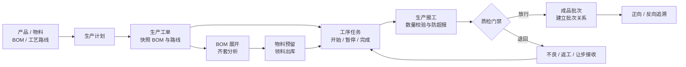

# 智造执行 MES · SmartMES

> 面向离散制造业的轻量级 MES。把「计划 → 工单 → 物料预留 → 领料 → 工序报工 → 质检 → 批次追溯」串成一条可运行、可验证的生产闭环，并用一张数字随工单呈现车间现场。

[](https://openjdk.org/)
[](https://spring.io/projects/spring-boot)
[](https://spring.io/projects/spring-cloud)
[](https://www.mysql.com/)
[](#验证结果)
[](docker-compose.yml)

[项目简介](#项目简介) · [项目界面](#项目界面) · [业务闭环](#业务闭环) · [系统架构](#系统架构) · [快速开始](#快速开始) · [关键设计](#关键设计) · [文档索引](#文档索引)


---

## 项目简介

SmartMES 是一个面向**离散制造**场景的 MES 工程作品。它不试图替代 ERP，而是补齐计划层与车间执行层之间的断层：

- 计划排了什么，工单是否已经下达？
- 仓库有没有料，预留和可用库存是否足够？
- 当前做到哪道工序，谁在操作，报工数量对不对？
- 质检有没有放行，后道为什么还不能开始？
- 成品出了问题，能不能追到原料批次和供应商？

项目围绕演示产品 **智能电表 X1** 展开：一份 7 行 BOM、一条 3 道工序的工艺路线、若干带批次的原材料和一组不同角色的演示账号。打开工作台，看到的不是孤立的 CRUD 页面，而是一条跟着产品穿过工序、库存和质量门禁的生产链路。

### 面向谁

| 角色 | 最关心的问题 | 对应页面 |
|---|---|---|
| 生产计划员 / 车间主管 | 今天做到哪了？哪张工单会拖交期？ | 生产运营、生产工单 |
| 班组长 / 操作工 | 当前工序做什么？如何开始、暂停和报工？ | 工序任务、工单详情 |
| 仓库协同人员 | 物料齐不齐？现有量、预留量、可用量各是多少？ | 库存与物料 |
| 质检员 | 哪道工序卡在质量门禁？能否放行？ | 质检任务 |
| 质量 / 售后人员 | 成品用了哪些原料？原料流向了哪些成品？ | 批次追溯 |

### 能力边界

| 维度 | 本项目覆盖 | 不覆盖 |
|---|---|---|
| 制造类型 | 离散制造、组装类生产 | 流程制造、连续生产 |
| 生产模式 | MTO 为主，兼顾简单 MTS | ATO / ETO、复杂混流 |
| 排程 | 人工指定计划日期 | APS 自动排程与产能仿真 |
| BOM / MRP | 多层 BOM 树、单层物料需求计算 | 递归 MRP、提前期、批量规则 |
| 组织 | 单工厂、单车间、多工作中心 | 多工厂、多组织、集团部署 |
| 设备 | 人工报工 | SCADA、OPC-UA、OEE 实时采集 |
| 定位 | 可演示、可验证的工程作品 | 未经改造直接商用的生产系统 |

---

## 项目界面

工作台入口为 **http://localhost:9000/**，由网关直接托管，使用原生 HTML / CSS / JavaScript，无 Node 构建步骤。默认进入演示数据模式，登录后连接真实 REST 接口。

视觉上采用深海军蓝导航、浅蓝车间实景背景和白色数据面板。蓝色表示主操作与进行中状态，红色只留给阻断、逾期和缺口，橙色用于质检门禁与提醒。工单号、批次号和数量使用等宽数字，便于在队列中纵向比较。

**首页：先处理当前执行，再看班次分析。** 首屏是正在流动的数字随工单，右侧只列会阻断后道的异常，下方再展开生产趋势、工单队列与协同信息。

| 生产工单 | 库存与物料 |
|:---:|:---:|
|  |  |
| 按状态、交期与阻断风险组织工单，支持筛选和新建 | 现有量、预留量、可用量来自同一套库存模型，缺口直接指向补料动作 |

| 质检任务 | 批次追溯 |
|:---:|:---:|
|  |  |
| 质检点阻断后道工序，放行或退回都有明确结果 | 从成品追到原料与供应商，也能从原料反查受影响成品 |

> 截图基于内置演示数据，时间与状态会随本地环境变化。

### 工作台不是装饰层

- **数字随工单**：真实工序号 10 / 20 / 30 串联路线，质检点以门禁节点标记，路线只填充到当前工序。
- **行动优先**：待办区只放缺料、质检门禁、待下达等会阻断生产的事件，并附带可执行入口。
- **数据口径明确**：不跨计量单位相加；完成率、合格率都标注统计范围；演示数据与真实接口数据明确区分。
- **不伪造图表**：生产趋势来自工单计划 / 实际完工日聚合，没有后端时间序列时不做插值曲线。
- **零构建前端**：原生 HTML / CSS / JS + hash 路由，网关静态托管即可运行。

页面路由：

| 路由 | 内容 |
|---|---|
| `#/today` | 当前执行、KPI、生产趋势、工单状态、生产动态、批次脉络 |
| `#/orders` | 工单列表、状态筛选、分页、创建工单 |
| `#/orders/:id` | 工艺路线、流转历史、齐套、报工、质检与状态操作 |
| `#/tasks` | 工序任务队列、开始 / 暂停 / 完成、派工、报工 |
| `#/materials` | 三量库存、安全库存、预留、领退料、对账 |
| `#/basic` | 产品、物料、BOM、工艺路线只读视图 |
| `#/quality` | 待质检任务、放行与退回 |
| `#/trace` | 正向与反向批次追溯 |

---

## 业务闭环



一次完整演示会走通以下步骤：

1. 登录并获取 JWT，通过网关访问各业务服务。
2. 查询生效 BOM 与工艺路线。
3. 创建生产计划与工单，锁定当时的 BOM / 工艺版本。
4. 审核、下达工单，幂等生成工序任务。
5. 计算物料需求并执行齐套分析。
6. 预留物料、领料出库并记录批次。
7. 执行工序开始、暂停、恢复与完成。
8. 分批报工，验证超报与数量不匹配会被拒绝。
9. 到达质检点触发门禁，放行后后道才可继续。
10. 所有工序完成后自动完工，重算进度且重复执行不翻倍。
11. 建立成品批次关系，执行正反向追溯。
12. 对账库存表、流水与预留记录，确认账实一致。

---

## 系统架构


### 服务职责

| 服务 | 端口 | 职责 | 独立数据库 |
|---|---:|---|---|
| `smart-gateway` | 9000 | 路由、JWT 验签、用户信息透传、traceId、静态工作台 | — |
| `smart-system` | 9001 | 用户、角色、登录 | `smart_system` |
| `smart-product` | 9002 | 产品、物料、BOM、工艺路线 | `smart_product` |
| `smart-production` | 9003 | 计划、工单、工序、报工、outbox | `smart_production` |
| `smart-inventory` | 9004 | 三量库存、预留、领退料、流水、对账 | `smart_inventory` |
| `smart-quality` | 9005 | 质检、批次、正反向追溯 | `smart_quality` |

服务按**事务边界 + 变更频率 + 故障隔离**拆分。生产与工序合并，因为报工是工单进度的唯一来源；库存独立，因为并发扣减与对账是技术密度最高的部分；质量独立，因为质检项、不良代码和批次关系有独立模型。五个数据库禁止跨库 JOIN，跨域数据通过 REST 查询或冗余快照获取。

### 技术栈

| 技术 | 版本 | 用途 |
|---|---|---|
| Java | 21 | 语言与运行时 |
| Spring Boot | 3.3.6 | 基础框架、自动配置、Actuator |
| Spring Cloud | 2023.0.1 | 微服务版本对齐 |
| Spring Cloud Alibaba | 2023.0.1.0 | Nacos 注册与配置 |
| Spring Cloud Gateway | 4.1.x | 统一入口、JWT、traceId |
| MyBatis-Plus | 3.5.5 | 数据访问、分页、条件更新 |
| MySQL | 8.0+ | 五个独立业务库 |
| Redis | 7（可选） | 登录态等可选能力，不作为库存锁 |
| RabbitMQ | 3.x（可选） | 报工事件异步投递与 outbox 发布 |
| Knife4j | 4.4.0 | OpenAPI 接口文档 |
| JUnit 5 | Spring Boot 管理版本 | 状态机、库存、报工、追溯测试 |
| Docker Compose | — | 镜像构建与本地编排 |

---

## 关键设计

| 问题 | 本项目的选择 | 没有采用的方案 | 原因 |
|---|---|---|---|
| 并发预留库存 | 数据库条件更新 | Redis 分布式锁 / 悲观锁 | 判断与更新在同一条 SQL，无锁租约和额外故障点 |
| 报工事件可靠性 | 本地消息表 + publisher confirm | Seata 强一致事务 | 允许分钟级最终一致，核心链路不依赖事务协调器 |
| 工单进度更新 | 按报工结果重算 | 收到消息后累加 | 重算天然幂等，重复消费不会让进度翻倍 |
| 批次追溯 | 关系表 DAG + BFS | 图数据库 / 嵌套集 | 当前数据量无需引入新组件 |
| 历史工单还原 | 创建时快照 BOM / 工艺版本 | 查询当前生效版本 | 主数据升级不能改变已下达工单的用料和路线 |
| 生产排程 | 人工指定日期 | APS 算法 | 没有真实产能约束，自动排程只会制造伪精度 |

### 库存并发

库存采用「现有量 / 预留量 / 可用量」三量模型。预留用一条带条件的 `UPDATE` 完成判断与扣减，避免“先查再改”的竞态；多物料操作按 `material_id` 排序，降低死锁概率。并发测试中 100 个线程同时预留，未出现超发；第 3 个物料不足时，前两个物料的预留会整体回滚。

### 工单状态机

工单使用八状态模型、统一流转入口、迁移表校验和 CAS 条件更新。下达时幂等生成工序任务；报工后根据报工汇总重算进度；所有流转写入状态日志，便于还原历史。

### 报工与消息

服务端强制校验 `合格数 + 不良数 = 报工数`，条件更新防止超报，报工单号保证幂等。业务数据与 outbox 事件在同一事务内写入，再由发布器异步投递；RabbitMQ 未启动时 outbox 仍会落库，不阻断核心业务。

### 批次追溯

批次关系以有向无环图建模，反向追溯从成品到原料和供应商，正向追溯从原料到受影响成品。查询使用 BFS，并加入环路防护和深度限制，避免异常数据导致无限递归或超大结果集。

### 数据边界

BOM 和工艺路线采用「草稿 → 生效 → 失效」版本模型，同一产品同时只能有一个生效版本。工单创建时快照 `bom_id` 和 `route_id`，后续主数据升级不会改变历史工单。BOM 树支持多层展开和环路检测，但物料需求计算刻意只做单层成品到原材料。

---

## 快速开始

### 环境要求

| 依赖 | 版本 | 必需 | 用途 |
|---|---|---|---|
| JDK | 21+ | 是 | 编译与运行 |
| Maven | 3.8+ | 是 | 构建 |
| MySQL | 8.0+ | 是 | 五个业务库 |
| Docker / Compose | 较新版本 | 否 | 一键启动依赖与服务 |
| Redis | 7+ | 否 | 可选能力 |
| RabbitMQ | 3.x | 否 | 报工事件异步投递 |
| Nacos | 2.x+ | 否 | 注册与配置；本机可直连服务地址 |

### 方式一：Docker Compose（推荐）

```bash
docker compose up -d --build
docker compose ps
```

编排包含 MySQL、Redis、RabbitMQ、Nacos 和 6 个应用服务，共 10 个容器。MySQL 映射宿主机 **13306** 端口，初始化脚本只在数据卷首次创建时执行；修改表结构后需先执行 `docker compose down -v`。

启动后打开 **http://localhost:9000/**。

> Docker Compose 已在 Windows + Docker Desktop 环境完成端到端实测，详细排障见 [`docs/09-部署文档.md`](docs/09-部署文档.md)。

### 方式二：本机多进程启动

<details>
<summary>展开查看数据库初始化、构建与启动命令</summary>

```bash
# 00_create_databases.sql 会 DROP 并重建 5 个数据库，请勿对已有数据环境执行
mysql -uroot -p123456 < sql/00_create_databases.sql
mysql -uroot -p123456 < sql/01_schema_product.sql
mysql -uroot -p123456 < sql/02_schema_production.sql
mysql -uroot -p123456 < sql/03_schema_inventory.sql
mysql -uroot -p123456 < sql/04_schema_quality.sql
mysql -uroot -p123456 < sql/05_schema_system.sql
mysql -uroot -p123456 < sql/06_init_data.sql
```

```bash
mvn clean package -DskipTests
```

每个服务使用一个终端，建议按以下顺序启动：

```bash
java -jar smart-system/target/smart-system-1.0.0.jar
java -jar smart-product/target/smart-product-1.0.0.jar
java -jar smart-inventory/target/smart-inventory-1.0.0.jar
java -jar smart-quality/target/smart-quality-1.0.0.jar
java -jar smart-production/target/smart-production-1.0.0.jar
java -jar smart-gateway/target/smart-gateway-1.0.0.jar
```

没有启动 RabbitMQ / Nacos 时可关闭可选依赖：

```powershell
$env:SMART_MQ_ENABLED="false"
$env:NACOS_REGISTER="false"
```

```bash
# Linux / macOS
export SMART_MQ_ENABLED=false
export NACOS_REGISTER=false
```

网关默认直连 `localhost:9001` ～ `9005`。服务部署在其他主机时，可用 `SYSTEM_SERVICE_URL`、`PRODUCT_SERVICE_URL`、`PRODUCTION_SERVICE_URL`、`INVENTORY_SERVICE_URL`、`QUALITY_SERVICE_URL` 覆盖。

</details>

### 仅预览工作台

无需启动后端即可浏览演示数据：

```bash
python -m http.server 4173 --directory smart-gateway/src/main/resources/static
```

打开 **http://127.0.0.1:4173/**。此时所有操作只改浏览器内存；右上角登录会尝试连接 `localhost:9000` 的网关。登录失败不会伪装成功，401 时会清除本地 JWT 并回退演示模式。

### 演示账号

| 用户名 | 密码 | 角色 | 主要职责 |
|---|---|---|---|
| `admin` | `123456` | ADMIN | 全部权限 |
| `planner` | `123456` | PLANNER | 创建计划、工单，审核下达 |
| `warehouse` | `123456` | WAREHOUSE | 预留、领料、退料、入库 |
| `operator` | `123456` | OPERATOR | 工序开始 / 暂停 / 完成、报工 |
| `inspector` | `123456` | INSPECTOR | 质检录入、批次查询、放行 |

> 角色已写入 JWT 并透传给下游服务，但当前尚未实现接口级 RBAC；演示账号主要用于展示业务流程。

---

## 接口与文档

所有业务接口统一从网关进入：

| 前缀 | 转发至 |
|---|---|
| `/system/**` | `smart-system` |
| `/product-service/**` | `smart-product` |
| `/production-service/**` | `smart-production` |
| `/inventory-service/**` | `smart-inventory` |
| `/quality-service/**` | `smart-quality` |

网关会校验 JWT，并把 `X-User-Id`、`X-User-Name`、`X-User-Role` 和 `X-Trace-Id` 透传给下游服务。业务服务不应直接暴露公网，否则这些请求头可以被伪造。

| 服务 | Knife4j 地址 |
|---|---|
| 系统 | http://localhost:9001/doc.html |
| 基础资料 | http://localhost:9002/doc.html |
| 生产执行 | http://localhost:9003/doc.html |
| 库存 | http://localhost:9004/doc.html |
| 质量追溯 | http://localhost:9005/doc.html |

---

## 验证结果

项目不只验证“能编译”，还验证关键业务不变量：

| 验证项 | 结果 | 证据 |
|---|---|---|
| 单元测试 | **127 / 127 通过** | 覆盖状态机、报工、库存、追溯、认证与需求计算 |
| 完整业务闭环 | **50 / 50 检查点** | `demo/FullChainDemo.java` 经网关执行 20 个步骤 |
| 库存并发 | **100 并发零超发** | 库存 50 时精确 50 成功、50 失败 |
| 事务回滚 | **多物料预留全回滚** | 第 3 个物料不足时，前两个物料预留恢复为 0 |
| 工作台回归 | **通过** | 报工、质检门禁、工单创建 / 下达、追溯、登录错误均完成浏览器验收 |
| 移动端布局 | **通过** | 390px 视口无横向溢出，导航切换为底部栏 |
| Docker Compose | **10 个容器全部 healthy** | 2026-10-31 在 Windows + Docker Desktop 完成端到端验证 |

复现核心验证：

```bash
# 单元测试
mvn test

# 完整闭环（需要先启动 6 个服务）
java -cp ".mvn/repo/com/fasterxml/jackson/core/jackson-databind/2.17.3/jackson-databind-2.17.3.jar;.mvn/repo/com/fasterxml/jackson/core/jackson-core/2.17.3/jackson-core-2.17.3.jar;.mvn/repo/com/fasterxml/jackson/core/jackson-annotations/2.17.1/jackson-annotations-2.17.1.jar" demo/FullChainDemo.java

# 库存并发：100 线程，物料 1，每次预留 1
java perf-test/PerfInventoryConcurrency.java 100 1 1 100
```

完整环境、执行记录和边界说明见 [`docs/08-测试报告.md`](docs/08-测试报告.md)。

---

## 项目结构

```text
smart-manufacturing/
├── pom.xml                         父 POM，统一版本管理
├── smart-common/                   公共返回、异常、审计字段、traceId
├── smart-gateway/      :9000       网关 + JWT + traceId + 静态工作台
├── smart-system/       :9001       用户 / 角色 / 登录
├── smart-product/      :9002       产品 / 物料 / BOM / 工艺路线
├── smart-production/   :9003       计划 / 工单 / 工序 / 报工 / outbox
├── smart-inventory/    :9004       三量库存 / 预留 / 领退料 / 对账
├── smart-quality/      :9005       质检 / 批次 / 正反向追溯
├── smart-gateway/src/main/resources/static/
│                                   工作台 HTML / CSS / JS
├── sql/                            建库、建表与初始化数据
├── docs/                           设计、测试、部署与前端说明
├── demo/FullChainDemo.java         完整链路验证程序
├── perf-test/                      库存并发验证程序
├── docker-compose.yml              基础设施 + 6 个服务编排
└── README.md
```

| 指标 | 数量 |
|---|---:|
| 生产 Java 代码 | 114 个文件 / 9,542 行 |
| 测试 Java 代码 | 14 个文件 / 2,706 行 |
| SQL 脚本 | 8 个文件 / 956 行 |
| 工作台静态资源 | 6 个文件 / 6,400 行 |
| 数据表 | 27 张，分布在 5 个独立数据库 |
| REST 端点 | 95 个，来自 11 个 Controller |
| 单元测试 | 127 个用例 |
| 完整闭环检查点 | 50 个 |

---

## 已知限制

- **物料需求只做单层 BOM**：多层 BOM 树可以展示和检测环路，但不递归展开半成品。
- **没有自动排程**：计划日期由人工指定，不做产能校验或 APS 优化。
- **单工厂、单仓库**：`warehouse_id` 已建模，但当前固定为 1。
- **质检与生产不在同一事务**：通过 `WAIT_INSPECTION` 状态门禁协同，不引入跨服务分布式事务。
- **没有接口级 RBAC**：角色已建模并写入 JWT，但未使用 `@PreAuthorize` 做细粒度授权。
- **定时任务缺少分布式锁**：多实例部署时 outbox 投递和对账任务可能重复执行。
- **基础资料页只读**：产品、物料、BOM、工艺路线的维护表单与写入接口本期未接入。
- **移动端首页未折叠**：小屏下工作台仍然偏长，建议直接进入对应详情路由。
- **不是可直接商用的生产系统**：缺少审计、数据权限、监控告警、备份恢复和完整安全加固。

---

## 文档索引

| 文档 | 内容 |
|---|---|
| [`docs/01-需求与设计说明书.md`](docs/01-需求与设计说明书.md) | 业务背景、范围边界、服务拆分依据 |
| [`docs/02-数据库设计.md`](docs/02-数据库设计.md) | 表结构、字段说明、索引设计、ER 图 |
| [`docs/03-工单状态机设计.md`](docs/03-工单状态机设计.md) | 迁移表、统一入口、CAS 与并发说明 |
| [`docs/04-业务流程图.md`](docs/04-业务流程图.md) | 业务主流程与异常分支 |
| [`docs/05-库存并发控制方案.md`](docs/05-库存并发控制方案.md) | 三量模型、方案对比、并发实测 |
| [`docs/06-报工与消息可靠性设计.md`](docs/06-报工与消息可靠性设计.md) | 防超报、outbox、confirm、幂等 |
| [`docs/07-批次追溯设计.md`](docs/07-批次追溯设计.md) | DAG 建模、BFS、防环、深度限制 |
| [`docs/08-测试报告.md`](docs/08-测试报告.md) | 测试环境、真实结果、缺陷修复 |
| [`docs/09-部署文档.md`](docs/09-部署文档.md) | 环境准备、启动步骤、故障排查 |
| [`docs/10-面试题库.md`](docs/10-面试题库.md) | 40+ 设计问题与取舍说明 |
| [`docs/11-前端工作台.md`](docs/11-前端工作台.md) | 工作台目标用户、设计概念、路由与数据口径 |
| [`docs/环境与构建说明.md`](docs/环境与构建说明.md) | 离线 Maven、注解处理器等构建记录 |

---

## 许可

本项目为个人学习与求职展示作品，代码采用 Apache 2.0 许可，仅用于教学、演示和二次学习。若用于真实生产环境，需要补齐权限、审计、监控、备份、安全与容量规划。
