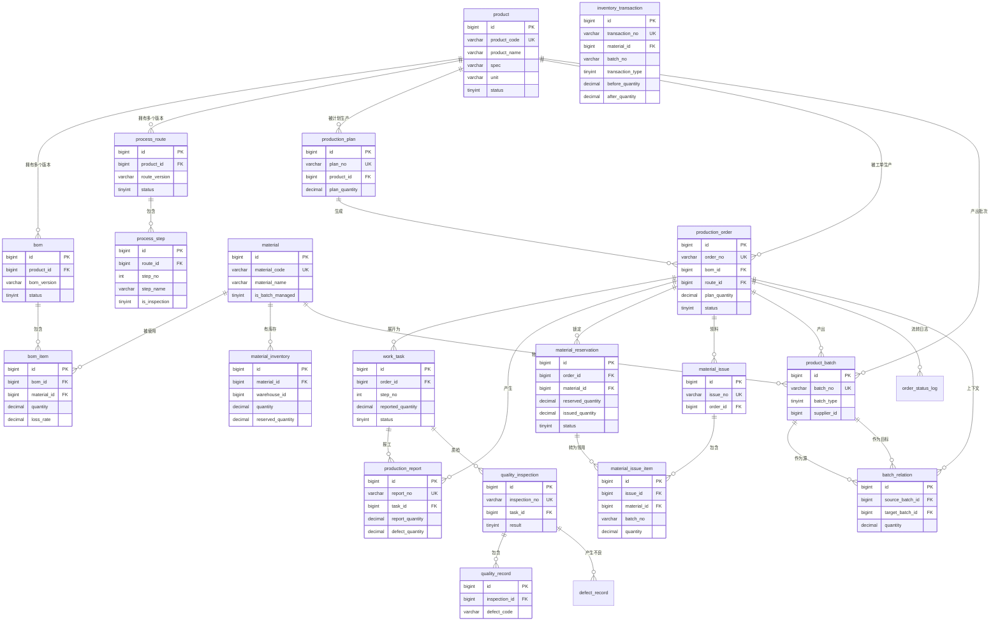

# 数据库设计

> 23 张表（5 个独立库），全部 DDL 见 `sql/` 目录。
> 本文档说明**设计原则、表清单、关键字段的"为什么"**。

---

## 1. 八条设计原则

| # | 原则 | 说明 |
|---|---|---|
| 1 | **每服务独立库** | `smart_system` / `smart_product` / `smart_production` / `smart_inventory` / `smart_quality`。**禁止跨库 JOIN**，跨域数据用服务调用查，或在单据里冗余快照 |
| 2 | **业务单据必须有业务编码** | 不对外暴露自增 id。`order_no` / `plan_no` / `batch_no` / `issue_no` / `report_no` 都要有唯一索引 |
| 3 | **状态流转必须有 CAS 前置条件** | 所有 `UPDATE ... SET status` 都带 `AND status = #{expected}` |
| 4 | **账本表只增不改** | `inventory_transaction` / `quality_record` / `order_status_log` 不允许 UPDATE/DELETE |
| 5 | **有意反范式** | 单据冗余存名称/规格快照，防止主数据变更影响历史单据 |
| 6 | **逻辑删除 + 唯一索引的冲突** | 唯一索引统一带上 `is_deleted`；或基础资料用**物理删除** |
| 7 | **数量用 DECIMAL(18,4)** | 支持小数用量（如 0.05kg）；工时 `DECIMAL(10,2)`；损耗率 `DECIMAL(6,4)` |
| 8 | **每张表都有审计字段** | `create_time` / `update_time`；业务单据加 `create_by` / `update_by` |

### 1.1 原则 6 的详细说明（最容易踩的坑）

**问题**：产品表有 `uk_product_code`。如果用逻辑删除：

```
创建产品 PRD-001 → 逻辑删除（is_deleted=1，行还在）
再次创建 PRD-001 → 唯一索引冲突 ❌（因为旧行还占着编码）
```

**两种解法**：

| 方案 | 做法 | 问题 |
|---|---|---|
| A | 唯一索引改为 `(product_code, is_deleted)` | 删除两次就冲突（两条 is_deleted=1） |
| B | **基础资料用物理删除** | 需要业务校验"是否被引用" |

**本项目选择**：**基础资料（product / material）物理删除**，业务单据逻辑删除。

原因：
- 基础资料被单据引用时，单据里存的是 **id + 快照**，物理删除不影响历史数据
- 删除前校验"是否被 BOM / 工单引用"（代码里已实现）
- 业务单据（工单、计划）需要保留历史，用逻辑删除 + 唯一索引带 `is_deleted`

---

## 2. 表清单

### 2.1 smart_system（3 张）

| 表 | 用途 | 关键索引 |
|---|---|---|
| `sys_user` | 用户（BCrypt 密码） | `uk_username` |
| `sys_role` | 角色 | `uk_role_code` |
| `sys_user_role` | 用户角色关联 | `uk_user_role(user_id, role_id)` |

### 2.2 smart_product（6 张）

| 表 | 用途 | 关键索引 |
|---|---|---|
| `product` | 产品（成品/半成品） | `uk_product_code` |
| `material` | 物料（原料/辅料/包装） | `uk_material_code`、`idx_material_type` |
| `bom` | BOM 主表（**版本化**） | `uk_product_version(product_id, bom_version)`、`idx_product_status` |
| `bom_item` | BOM 明细 | `uk_bom_material(bom_id, material_id)`、`idx_bom_id` |
| `process_route` | 工艺路线主表（**版本化**） | `uk_product_route_version`、`idx_product_status` |
| `process_step` | 工序步骤 | `uk_route_step_no(route_id, step_no)` |

### 2.3 smart_production（6 张）

| 表 | 用途 | 关键索引 |
|---|---|---|
| `production_plan` | 生产计划 | `uk_plan_no(plan_no, is_deleted)`、`idx_plan_end_date` |
| `production_order` | **生产工单（核心单据）** | `uk_order_no(order_no, is_deleted)`、`idx_order_status`、`idx_order_product_status` |
| `work_task` | 工序任务 | **`uk_order_step(order_id, step_no)`**、`idx_task_status_operator` |
| `production_report` | 生产报工（明细账） | `uk_report_no`、`idx_report_task` |
| `order_status_log` | 工单状态流转日志（只增） | `idx_log_order` |
| `mq_outbox` | **本地消息表** | `uk_outbox_biz(biz_key, exchange_name)`、`idx_outbox_status_retry` |
| `mq_consume_log` | 消费幂等记录 | `uk_consume_key` |

### 2.4 smart_inventory（6 张）

| 表 | 用途 | 关键索引 |
|---|---|---|
| `material_inventory` | **物料库存（三量模型，并发核心）** | **`uk_material_warehouse(material_id, warehouse_id)`** |
| `inventory_transaction` | **库存流水（账本，只增）** | `uk_transaction_no`、`idx_tx_material_batch`、`idx_tx_biz_no` |
| `material_reservation` | 物料预留 | **`uk_order_material(order_id, material_id)`**、`idx_reservation_status_expire` |
| `material_issue` | 领料单 | `uk_issue_no`、`idx_issue_order` |
| `material_issue_item` | **领料明细（批次追溯关键）** | `idx_issue_item_material_batch(material_id, batch_no)` |
| `inventory_reconcile_log` | 库存对账日志 | `idx_reconcile_material` |

### 2.5 smart_quality（5 张）

| 表 | 用途 | 关键索引 |
|---|---|---|
| `product_batch` | **批次（物料+产品，追溯图节点）** | `uk_batch_no`、`idx_batch_supplier` |
| `batch_relation` | **批次关系链（追溯图边）** | `idx_relation_source`（正向）、`idx_relation_target`（反向） |
| `quality_inspection` | 质检单 | `uk_inspection_no`、`idx_inspection_task` |
| `quality_record` | 质检明细（只增） | `idx_record_defect_code` |
| `defect_record` | 不良品记录 | `uk_defect_no`、`idx_defect_code` |

**合计：27 张表**（其中 23 张核心表 + 4 张辅助表）。

---

## 3. 核心表详解

### 3.1 production_order（生产工单）—— 系统核心单据

```sql
CREATE TABLE production_order (
    id                  BIGINT PRIMARY KEY AUTO_INCREMENT,
    order_no            VARCHAR(64)  NOT NULL,          -- 业务编码 WO+日期+序列
    plan_id             BIGINT,                         -- 来源计划
    product_id          BIGINT       NOT NULL,          -- 生产什么

    -- 🔑 版本快照（最重要的设计）
    bom_id              BIGINT       NOT NULL,          -- 锁定的 BOM 版本
    bom_version         VARCHAR(32),                    -- 版本号快照
    route_id            BIGINT       NOT NULL,          -- 锁定的工艺路线版本
    route_version       VARCHAR(32),

    -- 反范式快照（防主数据变更影响历史）
    product_code        VARCHAR(64),
    product_name        VARCHAR(128),
    spec                VARCHAR(255),
    unit                VARCHAR(16),

    plan_quantity       DECIMAL(18,4) NOT NULL,
    completed_quantity  DECIMAL(18,4) NOT NULL DEFAULT 0,   -- 由报工重算驱动
    qualified_quantity  DECIMAL(18,4) NOT NULL DEFAULT 0,
    defect_quantity     DECIMAL(18,4) NOT NULL DEFAULT 0,
    progress            INT           NOT NULL DEFAULT 0,   -- 0-100

    status              TINYINT       NOT NULL DEFAULT 1,   -- 状态机 1-8
    plan_start_time     DATETIME,
    plan_end_time       DATETIME,
    actual_start_time   DATETIME,
    actual_end_time     DATETIME,

    create_by BIGINT, update_by BIGINT,
    create_time DATETIME NOT NULL DEFAULT CURRENT_TIMESTAMP,
    update_time DATETIME NOT NULL DEFAULT CURRENT_TIMESTAMP ON UPDATE CURRENT_TIMESTAMP,
    is_deleted  TINYINT  NOT NULL DEFAULT 0,

    UNIQUE KEY uk_order_no (order_no, is_deleted),
    KEY idx_order_status (status),
    KEY idx_order_product_status (product_id, status),
    KEY idx_order_plan_end_time (plan_end_time),
    KEY idx_order_plan_id (plan_id)
);
```

**为什么必须存 `bom_id` 和 `route_id`**（制造业铁律）：

- 如果只存 `product_id`，查物料需求时要用"产品当前生效 BOM"
- 但 BOM 可能已升级到 V2 → **正在生产的工单物料需求莫名变了**
- 存 `bom_id` 后，工单创建那一刻就"拍照"，之后 BOM 怎么改都不影响它

**为什么 `completed_quantity` 由报工重算驱动**：
- 手工填会出现"工单显示完工 100，但实际报工只有 80"的矛盾
- 由报工**重算**（不是累加），保证数据自洽且幂等

### 3.2 work_task（工序任务）

```sql
CREATE TABLE work_task (
    id BIGINT PRIMARY KEY AUTO_INCREMENT,
    order_id   BIGINT NOT NULL,
    order_no   VARCHAR(64),           -- 冗余，避免 JOIN
    step_no    INT    NOT NULL,       -- 工序号快照（10/20/30）
    step_name  VARCHAR(128) NOT NULL,
    work_center VARCHAR(64),
    plan_quantity      DECIMAL(18,4) NOT NULL,
    reported_quantity  DECIMAL(18,4) NOT NULL DEFAULT 0,   -- 🔑 超报校验用
    qualified_quantity DECIMAL(18,4) NOT NULL DEFAULT 0,
    defect_quantity    DECIMAL(18,4) NOT NULL DEFAULT 0,
    actual_hours       DECIMAL(10,2) NOT NULL DEFAULT 0,
    status     TINYINT NOT NULL DEFAULT 1,   -- 1-6
    is_inspection TINYINT NOT NULL DEFAULT 0,  -- 质检点快照
    operator_id BIGINT,
    start_time DATETIME, end_time DATETIME,
    ...
    UNIQUE KEY uk_order_step (order_id, step_no),   -- 🔑 防重复生成
    KEY idx_task_status_operator (status, operator_id)
);
```

**为什么 `reported_quantity` 存表而不是每次 `SUM(报工表)`**：

超报校验需要**原子性**。如果每次查 SUM 再判断，两个并发请求会同时通过校验。
存字段 + 条件更新 `WHERE reported_quantity + ? <= plan_quantity` 才能保证并发安全。
**这是"冗余换并发安全"的典型取舍。**

**为什么 `uk_order_step` 唯一索引这么重要**：
工单下达时要生成工序任务。如果重复下达（或 MQ 消息重投），
没有唯一索引就会生成两套任务 → **报工翻倍**。
**唯一索引是幂等的最后一道防线。**

**为什么 `step_no` 用 10/20/30 而不是 1/2/3**：
制造业惯例，留出插入空间。要在两道工序间加新工序用 15 即可，
不用重新编号所有后续工序。

### 3.3 material_inventory（物料库存）—— 并发核心

```sql
CREATE TABLE material_inventory (
    id BIGINT PRIMARY KEY AUTO_INCREMENT,
    material_id  BIGINT NOT NULL,
    warehouse_id BIGINT NOT NULL DEFAULT 1,
    quantity          DECIMAL(18,4) NOT NULL DEFAULT 0,  -- 现有量
    reserved_quantity DECIMAL(18,4) NOT NULL DEFAULT 0,  -- 预留量
    -- 可用量 = quantity - reserved_quantity（计算值，不存字段）
    safety_stock DECIMAL(18,4) NOT NULL DEFAULT 0,
    version      INT NOT NULL DEFAULT 0,   -- 乐观锁预留扩展
    ...
    UNIQUE KEY uk_material_warehouse (material_id, warehouse_id)
);
```

**为什么 `uk_material_warehouse` 必须唯一**：

所有条件更新都依赖"**单行记录**"：

```sql
UPDATE material_inventory SET reserved_quantity = reserved_quantity + ?
WHERE material_id = ? AND warehouse_id = ? AND quantity - reserved_quantity >= ?
```

如果同物料同仓库有多条记录，这个 UPDATE 会**同时更新多行**，
"影响行数 = 1"的判断就失效了 → 可能误判成功/失败。

**为什么可用量不存字段**：见 `docs/05-库存并发控制方案.md` §3.1。

### 3.4 inventory_transaction（库存流水）—— 账本

```sql
CREATE TABLE inventory_transaction (
    id BIGINT PRIMARY KEY AUTO_INCREMENT,
    transaction_no   VARCHAR(64) NOT NULL,
    material_id      BIGINT NOT NULL,
    warehouse_id     BIGINT NOT NULL DEFAULT 1,
    batch_no         VARCHAR(64),           -- 🔑 批次追溯起点
    transaction_type TINYINT NOT NULL,      -- 1入库 2出库 3预留 4释放 5退料 6盘点
    quantity         DECIMAL(18,4) NOT NULL,-- 变动量（带符号）
    before_quantity  DECIMAL(18,4) NOT NULL,-- 🔑 变动前
    after_quantity   DECIMAL(18,4) NOT NULL,-- 🔑 变动后
    before_reserved  DECIMAL(18,4) NOT NULL DEFAULT 0,
    after_reserved   DECIMAL(18,4) NOT NULL DEFAULT 0,
    biz_type VARCHAR(32), biz_no VARCHAR(64),  -- 业务关联
    operator_id BIGINT, operator_name VARCHAR(64),
    create_time DATETIME NOT NULL DEFAULT CURRENT_TIMESTAMP,
    UNIQUE KEY uk_transaction_no (transaction_no),
    KEY idx_tx_material_batch (material_id, batch_no),
    KEY idx_tx_biz_no (biz_no)
);
```

**为什么记 before/after 而不只记变动量**：
1. **对账**：末条流水的 `after_quantity` 应等于库存表当前 `quantity`
2. **排查并发 bug**：两条流水的 `before` 相同 → 说明有并发覆盖
3. **审计**：任何时刻的库存都可以从流水重建

**为什么只增不改**：账本一旦可改，审计价值就没了。
发现错误用**反向冲正**（再记一条相反流水），而不是修改历史。

代码层面：`InventoryTransactionMapper` **只有 insert 和 select**，
没有 update/delete 方法 —— 从接口层面断了"改历史"的可能。

**为什么 `batch_no` 是追溯起点**：
物料入库生成批次 → 领料记批次 → 完工生成产品批次 →
`batch_relation` 连接起来。没有 `batch_no`，追溯就断了。

### 3.5 material_reservation（物料预留）

```sql
CREATE TABLE material_reservation (
    id BIGINT PRIMARY KEY AUTO_INCREMENT,
    reservation_no VARCHAR(64) NOT NULL,
    order_id       BIGINT NOT NULL,
    material_id    BIGINT NOT NULL,
    warehouse_id   BIGINT NOT NULL DEFAULT 1,
    reserved_quantity DECIMAL(18,4) NOT NULL,
    issued_quantity   DECIMAL(18,4) NOT NULL DEFAULT 0,  -- 🔑 已领量
    status TINYINT NOT NULL DEFAULT 1,                   -- 1-4
    expire_time DATETIME,                                -- 🔑 防预留泄漏
    released_time DATETIME,
    ...
    UNIQUE KEY uk_order_material (order_id, material_id),  -- 🔑 幂等
    KEY idx_reservation_status_expire (status, expire_time)
);
```

**为什么需要 `issued_quantity`**：
预留 100，领了 30，还剩 70 待领。领料时要校验
`领用量 <= reserved_quantity - issued_quantity`。
没有这个字段就无法判断预留是否已用尽。

**为什么 `uk_order_material` 唯一**：同一工单同一物料只预留一次（幂等）。

**为什么需要 `expire_time`**：
工单取消/长期不生产时预留必须释放，否则库存被永久锁死。
定时任务扫 `status IN (1,2) AND expire_time < NOW()` 释放。

### 3.6 product_batch（批次）

```sql
CREATE TABLE product_batch (
    id BIGINT PRIMARY KEY AUTO_INCREMENT,
    batch_no   VARCHAR(64) NOT NULL,     -- MB…(物料) / PB…(产品)
    batch_type TINYINT NOT NULL,         -- 1-物料批次 2-产品批次
    material_id BIGINT,                  -- 物料批次用
    product_id  BIGINT,                  -- 产品批次用
    production_order_id BIGINT,          -- 产品批次关联工单
    quantity DECIMAL(18,4) NOT NULL DEFAULT 0,
    qualified_quantity DECIMAL(18,4) NOT NULL DEFAULT 0,
    supplier_id   BIGINT,                -- 🔑 追溯源头
    supplier_name VARCHAR(128),
    inbound_time  DATETIME,
    quality_status TINYINT DEFAULT 0,    -- 0未检 1合格 2不合格 3让步
    status TINYINT DEFAULT 1,
    ...
    UNIQUE KEY uk_batch_no (batch_no),
    KEY idx_batch_supplier (supplier_id)
);
```

**为什么物料批次和产品批次用一张表**：
- 结构高度相似
- **追溯时节点类型必须统一**，BFS 代码才能通用
- 代价：某些字段对某类型为 null（有意的取舍）

**为什么 `supplier_id` 关键**：质量事故的追溯终点往往是"哪个供应商的哪批料"。

### 3.7 batch_relation（批次关系）—— 追溯图的边

```sql
CREATE TABLE batch_relation (
    id BIGINT PRIMARY KEY AUTO_INCREMENT,
    source_batch_id BIGINT NOT NULL,   -- 被消耗的物料批次
    target_batch_id BIGINT,            -- 产出的产品批次（领料阶段可为空）
    production_order_id BIGINT,        -- 追溯上下文
    quantity DECIMAL(18,4) NOT NULL DEFAULT 0,
    relation_type VARCHAR(32) DEFAULT 'CONSUME',
    is_reversed TINYINT DEFAULT 0,     -- 退料冲正标记
    create_time DATETIME NOT NULL DEFAULT CURRENT_TIMESTAMP,
    KEY idx_relation_source (source_batch_id),   -- 正向追溯
    KEY idx_relation_target (target_batch_id),   -- 反向追溯
    KEY idx_relation_order (production_order_id)
);
```

**为什么是"有向图"而不是树**：
一个物料批次可用于多个产品批次（1:N），一个产品批次消耗多个物料批次（N:1）
⇒ 多对多 DAG。详见 `docs/07-批次追溯设计.md`。

### 3.8 mq_outbox（本地消息表）

```sql
CREATE TABLE mq_outbox (
    id BIGINT PRIMARY KEY AUTO_INCREMENT,
    biz_key       VARCHAR(128) NOT NULL,   -- 业务幂等键 report:123:order-progress
    exchange_name VARCHAR(128) NOT NULL,
    routing_key   VARCHAR(128) NOT NULL,
    payload       TEXT NOT NULL,           -- 消息体 JSON
    status        TINYINT NOT NULL DEFAULT 0,  -- 0待投递 1已投递 2失败 3路由退回
    retry_count   INT NOT NULL DEFAULT 0,
    next_retry_time DATETIME,              -- 指数退避
    last_error    VARCHAR(500),
    sent_time     DATETIME,
    ...
    UNIQUE KEY uk_outbox_biz (biz_key, exchange_name),  -- 🔑 同事件只写一条
    KEY idx_outbox_status_retry (status, next_retry_time)
);
```

**为什么需要**：解决"数据库更新成功、发 MQ 前宕机导致消息丢失"。
详见 `docs/06-报工与消息可靠性设计.md`。

---

## 4. ER 图



---

## 5. 索引设计检查

设计索引时用的方法：**把核心查询场景列出来，逐个确认有索引覆盖**。

| 查询场景 | 涉及表 | 索引 |
|---|---|---|
| 按工单号查工单 | production_order | `uk_order_no` |
| 看板：按状态筛工单 | production_order | `idx_order_status` |
| 按产品+状态查工单 | production_order | `idx_order_product_status` |
| 按交期排序 | production_order | `idx_order_plan_end_time` |
| 查工单的所有工序 | work_task | `idx_task_order` / `uk_order_step` 前缀 |
| 查"我的待办工序" | work_task | `idx_task_status_operator` |
| 防重复生成工序任务 | work_task | `uk_order_step` |
| 查某工序的报工明细 | production_report | `idx_report_task` |
| 报工单号幂等校验 | production_report | `uk_report_no` |
| 查库存（按物料+仓库） | material_inventory | `uk_material_warehouse` |
| **预留条件更新** | material_inventory | `uk_material_warehouse`（单行定位） |
| 查某物料的库存流水 | inventory_transaction | `idx_tx_material_batch` |
| 按业务单号查流水 | inventory_transaction | `idx_tx_biz_no` |
| 查工单的预留 | material_reservation | `idx_reservation_order` |
| 扫过期预留 | material_reservation | `idx_reservation_status_expire` |
| 领料单号幂等 | material_issue | `uk_issue_no` |
| 按物料+批次查领料明细 | material_issue_item | `idx_issue_item_material_batch` |
| 查当前生效 BOM | bom | `idx_bom_product_status` |
| 查产品所有 BOM 版本 | bom | `uk_product_version` 前缀 |
| 查生效工艺路线 | process_route | `idx_route_product_status` |
| 按工序号查工序 | process_step | `uk_route_step_no` |
| 批次号查询 | product_batch | `uk_batch_no` |
| **正向追溯**（原料→成品） | batch_relation | `idx_relation_source` |
| **反向追溯**（成品→原料） | batch_relation | `idx_relation_target` |
| 按供应商查批次 | product_batch | `idx_batch_supplier` |
| outbox 待投递扫描 | mq_outbox | `idx_outbox_status_retry` |
| outbox 幂等写入 | mq_outbox | `uk_outbox_biz` |

---

## 6. 数据库初始化顺序

```bash
mysql -uroot -p123456 < sql/00_create_databases.sql   # 建 5 个库（会 DROP）
mysql -uroot -p123456 < sql/01_schema_product.sql     # 基础资料
mysql -uroot -p123456 < sql/02_schema_production.sql  # 生产执行
mysql -uroot -p123456 < sql/03_schema_inventory.sql   # 库存
mysql -uroot -p123456 < sql/04_schema_quality.sql     # 质量
mysql -uroot -p123456 < sql/05_schema_system.sql      # 系统
mysql -uroot -p123456 < sql/06_init_data.sql          # 初始化数据
```

**必须按顺序执行**：`06_init_data.sql` 依赖所有建表脚本。

**初始化数据内容**（实测已插入）：

| 数据 | 数量 |
|---|---|
| 产品 | 3（智能电表 X1 / X2、控制板 C1 半成品） |
| 物料 | 10（芯片/表壳/螺丝/LCD/PCB/电容/电阻/导线/彩盒/铅封） |
| BOM | 3 套（32 行明细… 实际 16 行） |
| 工艺路线 | 3 条（8 道工序，含 2 个质检点） |
| 库存 | 10 条（含**期初入库流水**） |
| 物料批次 | 10 个（带供应商） |
| 用户 | 5（admin/planner/warehouse/operator/inspector，密码 123456） |
| 角色 | 5 |

**⚠️ `00_create_databases.sql` 会 `DROP DATABASE`**，重复执行会清空所有数据。

---

## 7. 已知限制

1. **无物理外键**：所有关联靠业务校验 + 索引。原因：微服务分库后外键无法跨库，
   且外键会带来锁竞争与迁移困难。**这是微服务架构的常规选择。**
2. **无分库分表**：单表数据量在演示规模远未到瓶颈。
   数据量大时按 `order_id` 哈希分表、按时间分区。
3. **无读写分离**：单 MySQL 实例。
4. **无数据归档**：历史工单不会归档（实际生产应把 N 年前数据归档到冷存储）。
5. **`material_inventory.version` 字段未使用**：本方案用条件更新，
   `version` 仅作扩展预留（若要改乐观锁可直接用）。
6. **`sys_user_role` 支持多角色，但业务代码只取主角色**（`roles.get(0)`）。
