# 核心业务流程图（8 张）

> 每张图标注了**异常分支** —— 异常分支才是 MES 的难点，正常流程谁都会画。

---

## 1. 生产工单创建流程

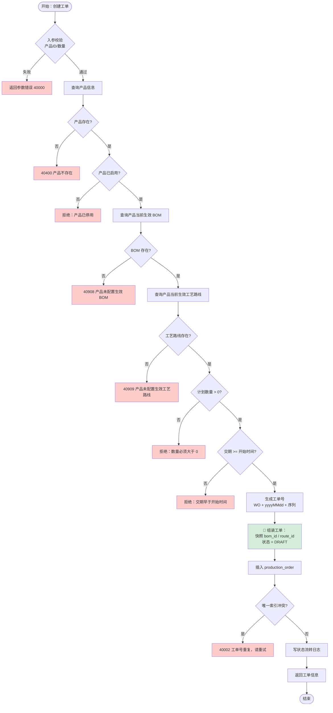

**关键设计说明**：

| 点 | 说明 |
|---|---|
| **快照 `bom_id` / `route_id`** | 工单创建时锁定版本。之后 BOM 升到 V2，这个工单仍用 V1 |
| **必须校验生效版本存在** | 没有 BOM 算不出物料需求，没有工艺路线生成不了工序任务。**宁可在创建时失败，也不要在下达时才发现** |
| **状态初始为 DRAFT** | 草稿可修改可删除，审核后才成为正式单据 |
| **工单号生成** | `WO + yyyyMMdd + 4位序列`，唯一索引兜底 |

**实测异常分支**：
```
✓ 产品编码重复 → 40002 产品编码已存在: PRD-DB-X1
✓ 草稿直接下达 → 40901 工单状态不允许从[草稿]流转到[已下达]
```

---

## 2. BOM 物料需求计算流程

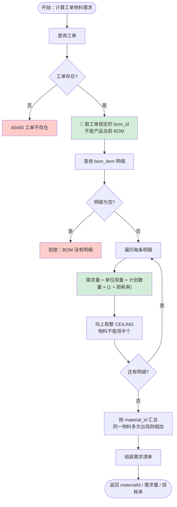

**关键设计说明**：

| 点 | 说明 |
|---|---|
| **用 `bom_id` 而不是 `product_id`** | 必须用工单锁定的版本，否则 BOM 升级后需求会变 |
| **损耗率** | 制造业必需。电商"买 1 件"就是 1 件；制造业"生产 1 个"可能要 1.02 份原料 |
| **向上取整** | 算出 100.3 个必须领 101 个 |
| **同物料汇总** | BOM 里同一物料可能出现多次，必须合并后再算，否则重复预留 |
| **不在此处扣库存** | 只计算，预留是下一步。**计算与扣减分离，职责清晰** |

**实测结果**（100 台电表 X1）：
```
MAT-MCU-01    单位用量=1.0  损耗=0.02  需求=102 颗     (1×100×1.02=102)
MAT-SHELL-01  单位用量=1.0  损耗=0.01  需求=101 个     (1×100×1.01=101)
MAT-SCREW-M3  单位用量=4.0  损耗=0.05  需求=420 颗     (4×100×1.05=420)
MAT-LCD-01    单位用量=1.0  损耗=0.03  需求=103 块     (1×100×1.03=103)
MAT-WIRE-01   单位用量=2.0  损耗=0.10  需求=220 米     (2×100×1.10=220)
```

**面试可讲的点：为什么不做多级 BOM 展开（完整 MRP）**
- 完整 MRP 需要递归展开半成品 BOM，还要考虑提前期、批量规则、安全库存
- 本项目只做**单层展开**（成品→原材料），场景是"直接采购原材料生产成品"
- 多级需要递归 + 层级需求传递，复杂度翻几倍
- **明确说"我做了简化，原因是…"比假装做了完整 MRP 更好**

---

## 3. 生产物料预留流程

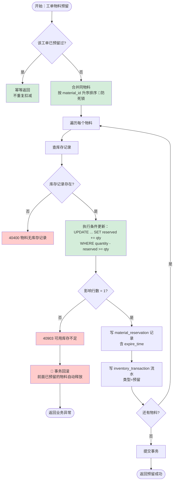

**核心 SQL（本周最重要的代码）**：

```sql
UPDATE material_inventory
SET reserved_quantity = reserved_quantity + #{qty}, update_time = NOW()
WHERE material_id = #{materialId}
  AND warehouse_id = #{warehouseId}
  AND quantity - reserved_quantity >= #{qty}   -- 🔑 判断与更新同一条 SQL
```

**为什么不用 Redis 分布式锁**：见 `docs/05-库存并发控制方案.md` §2.2。

**实测异常分支（事务回滚）**：

```
预留 物料1(需102) + 物料2(需101) + 物料4(需103, 只有5)
→ 40903 物料[MAT-LCD-01]可用库存不足

回滚验证：
  物料1 reserved = 0.0000  ✅ 已回滚
  物料2 reserved = 0.0000  ✅ 已回滚
  预留记录数 = 0           ✅ 无部分预留脏数据
```

---

## 4. 生产领料和退料流程

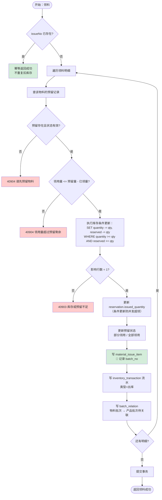

**领料核心 SQL**：

```sql
UPDATE material_inventory
SET quantity = quantity - #{qty},
    reserved_quantity = reserved_quantity - #{qty},
    update_time = NOW()
WHERE material_id = #{materialId}
  AND warehouse_id = #{warehouseId}
  AND quantity >= #{qty}            -- 现有量充足
  AND reserved_quantity >= #{qty}   -- 🔑 防绕过预留直接领货
```

**退料流程（反向）**：

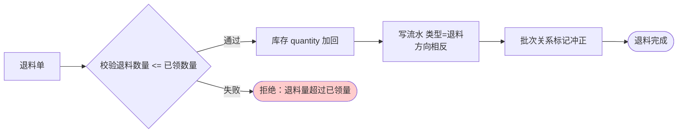

**为什么退料是"记反向流水"而不是"改原流水"**：
账本只增不改。改历史会让审计价值归零。

**实测幂等**：
```
第一次：IS-DEMO-001 领料成功，芯片 quantity 1000 → 898
第二次：同一单号重复提交
  → OK=true 幂等=true msg=单号已处理过（幂等返回，未重复处理）
  → 芯片库存未变: 现有=898.0 ✅
```

---

## 5. 生产工序流转流程

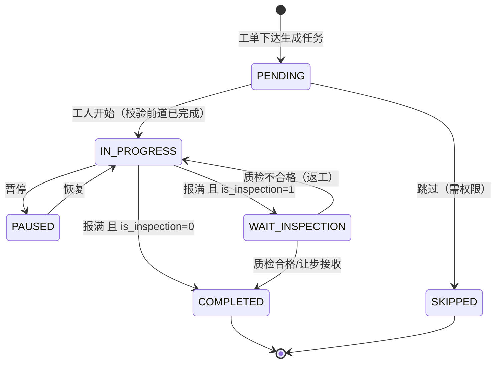

**开始工序的校验链**：

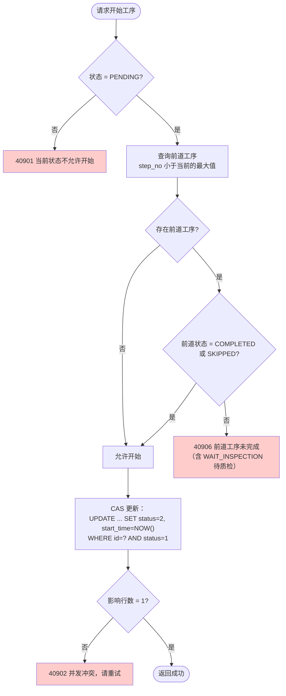

**关键设计说明**：

| 点 | 说明 |
|---|---|
| **工序顺序约束** | 前道未完成，后道不能开始。这是**工艺纪律**，不是可选项 |
| **取"前道最大 step_no"** | 不能简单 `step_no - 10`（工序号可能不连续，如插入 15） |
| **质检门禁** | 前道是 `WAIT_INSPECTION` 时也被拒绝（它不等于 COMPLETED） |
| **CAS 更新** | 两个人同时点"开始"，只有一个成功 |

**为什么要有 `PAUSED` 状态**：
设备故障、换料、交接班都会暂停。没有暂停状态，工人只能"假装没开始"或"假装已完成"，
**数据就失真了**。

**实测异常分支**：
```
✓ 跳过工序10 直接开始工序20 → 40906 前道工序[10-外壳组装]当前状态为[待开始]，未完成
✓ 工序20待质检时开始工序30 → 40906 前道工序[20-老化测试]当前状态为[待质检]，未完成
✓ 质检放行后开始工序30 → 成功
```

---

## 6. 生产报工流程

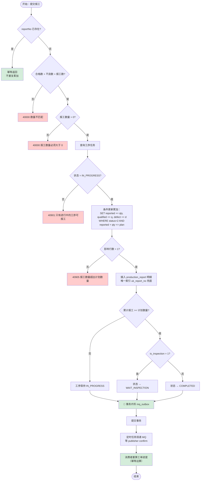

**报工累加核心 SQL**：

```sql
UPDATE work_task
SET reported_quantity  = reported_quantity  + #{qty},
    qualified_quantity = qualified_quantity + #{qualified},
    defect_quantity    = defect_quantity    + #{defect},
    actual_hours       = actual_hours       + #{hours},
    update_time = NOW()
WHERE id = #{taskId}
  AND status = 2                                    -- 必须进行中
  AND reported_quantity + #{qty} <= plan_quantity   -- 🔑 防超报
```

**关键设计说明**：

| 点 | 说明 |
|---|---|
| **报工单号幂等** | 防用户双击、网络重试 |
| **合格+不良=报工，服务端校验** | 前端校验不可信，三者不一致会让质量统计失真 |
| **条件更新防超报** | `WHERE reported + qty <= plan` 保证并发安全 |
| **MQ 通过 outbox 发** | 事务内写 outbox，提交后投递。**不直接发 MQ**，避免"事务回滚但消息已发" |
| **进度重算而非累加** | 消费者重算 `completed_quantity`，天然幂等 |

**为什么报工要单独一张表而不是直接改任务数量**：
- 报工是**明细账**，任务是**汇总账**
- 有明细才能追溯"谁在什么时候报了多少"
- 汇总账由明细汇总得出，数据自洽

**实测异常分支**：
```
✓ 合格数(15)+不良数(3)≠报工数(20) → 40000 必须等于报工数
✓ 60+50=110 > 计划 100 → 40905 报工数量超出计划数量
✓ 同一单号重复提交 → 幂等返回，累计仍为 40（未翻倍）
✓ 分批报工 60 → 未报满保持【进行中】→ 补报 40 → 【已完成】
```

---

## 7. 产品质量检验流程

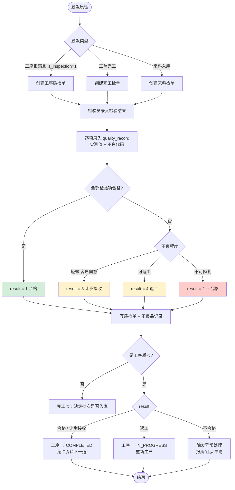

**关键设计说明**：

| 点 | 说明 |
|---|---|
| **质检是工序流转的门禁** | `is_inspection=1` 的工序必须质检合格/让步接收才能流转 |
| **result 四态而非二态** | 实际生产中轻微不良可让步接收，部分不良可返工。二元状态无法表达 |
| **质检合格 → 工序流转** | 通过 `WAIT_INSPECTION → COMPLETED` 的状态流转实现 |

**实测门禁行为**：
```
质检点工序报满 → 状态=待质检
后道工序尝试开始 → 40906 前道工序[...]当前状态为[待质检]，未完成
录入质检单 result=1（合格）→ 放行成功
后道工序可以开始
```

**为什么"让步接收"这个词重要**：
面试时能说出"让步接收"和"返工"，比会写 CRUD 更能体现制造业业务理解。

---

## 8. 产品批次追溯流程

### 8.1 追溯的数据结构：有向无环图

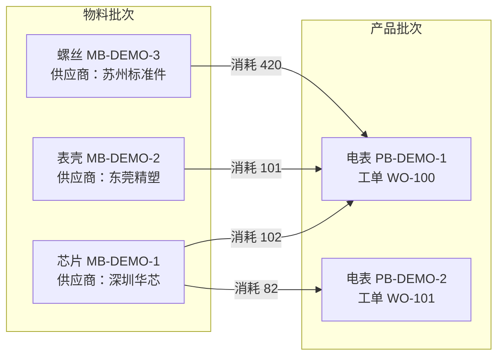

**为什么是图不是树**：一个物料批次可用于多个产品批次（1:N），
一个产品批次消耗多个物料批次（N:1）⇒ 多对多 DAG。

### 8.2 反向追溯（成品 → 原料）

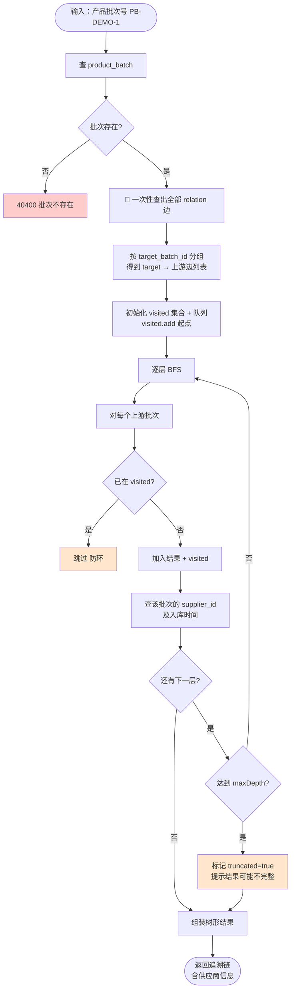

### 8.3 正向追溯（原料 → 成品）

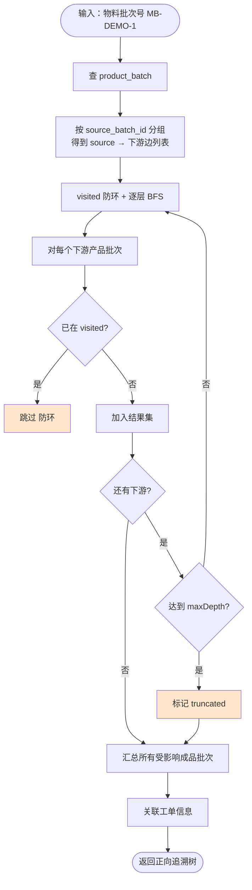

**关键设计说明**：

| 点 | 说明 |
|---|---|
| **有向无环图（DAG）** | 一个物料批次可用于多个产品批次，一个产品批次消耗多个物料批次 |
| **必须防环** | 数据配错可能形成环，BFS 必须用 `visited`，否则死循环 |
| **限制最大深度** | 默认 10 层，防止异常数据导致查询爆炸 |
| **截断必须提示** | `truncated=true` + 提示语，不能静默返回不完整数据 |
| **避免 N+1** | 一次查出所有关系边在内存遍历，避免递归 N+1 查询 |
| **关联质检结果** | 追溯不只要知道"用了什么料"，还要知道"检没检、合不合格" |

**实测结果**：

```
▶ 反向追溯（成品 → 原料 + 供应商）
    反向追溯完成：共涉及 4 个批次（含起点）
    └─ [MB-DEMO-1] MAT-1 演示物料1  数量=102.0  供应商=深圳华芯电子有限公司
    └─ [MB-DEMO-2] MAT-2 演示物料2  数量=101.0  供应商=东莞精塑制品厂
    └─ [MB-DEMO-3] MAT-3 演示物料3  数量=420.0  供应商=苏州标准件有限公司

▶ 正向追溯（原料 → 受影响的成品批次，精准召回）
    正向追溯完成：该批次影响 1 个下游批次
    └─ [PB-DEMO-1] PRD-DB-X1 智能电表 X1  数量=102.0

▶ 环路防护测试
    A→B→A 环形数据 → 安全返回，不死循环 ✅
    自环记录 → 拒绝（源批次与目标批次不能相同）✅
```

**追溯的业务价值（面试要讲）**：
- **质量事故召回**：某供应商芯片有缺陷 → 正向追溯查出所有用了该批次的成品 → **精准召回，不用全部召回**
- **客诉定位**：客户投诉某台电表 → 反向追溯查出用了哪些料、哪个供应商、哪道工序 → **定位根因**
- **合规要求**：汽车、医疗、电子行业强制要求批次可追溯

> **这是 MES 区别于普通 CRUD 系统最有说服力的能力。**
